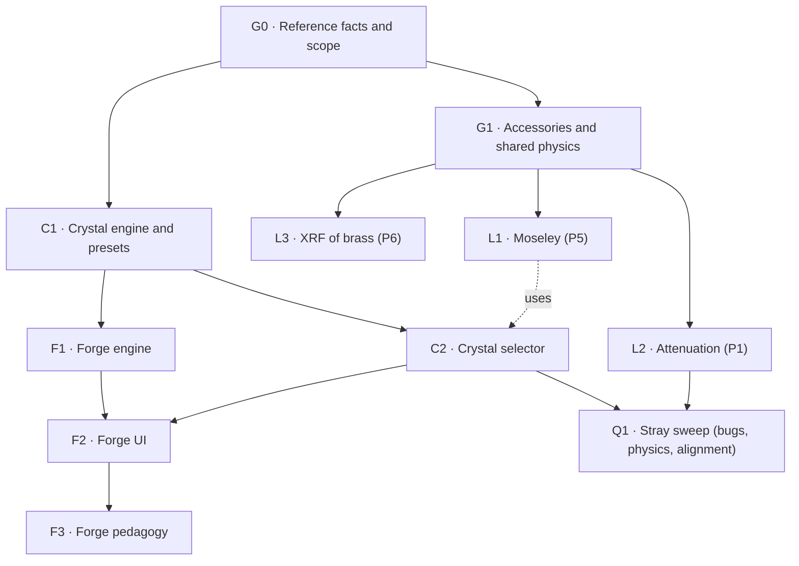
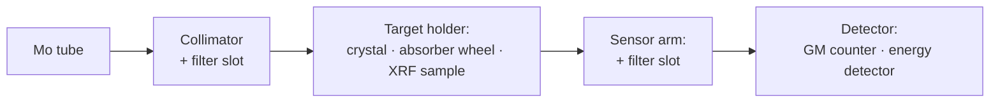

# New Features: Lab Practices, Crystal Library, Materials Forge

> [!abstract] Goal
> Grow the simulation from a single experiment (P6.3.3.1, Bragg at NaCl) into a small **X-ray lab** on the same
> emulated 554 800:
> 1. **Three new lab practices** from the EPN guides: attenuation (P1), Moseley's law (P5) and XRF of brass (P6).
> 2. A **crystal library**: pick NaCl, LiF, Si, calcite or mica (the crystals the lab uses) as the target.
> 3. A **Materials Forge**: design a lattice (cell, basis, cut plane) and get the spectrum it would produce.

**Contents:** [[#If you were sent here]] · [[#Status board]] · [[#How to work across sessions]] · [[#Ground rules]] ·
[[#Roadmap]] · [[#Part 0 — Groundwork]] · [[#Part I — Lab practices]] · [[#Part II — Crystal library]] ·
[[#Part III — Materials Forge]] · [[#Open questions]] · [[#Calibration anchors]] · [[#Risks]] · [[#Session log]]

---

## If you were sent here

> [!important] Claude: read this first when the user says "continue with Plan-New-Features" or "check what's done"
> This note is the **single source of truth** for this work. Don't rely on chat history.
> 1. **Where are we?** Check the frontmatter (`current_phase`, `next_task`), the [[#Status board]] and the newest entry in [[#Session log]].
> 2. **Check the claims against the repo** before building on them (ticks can drift):
>    - `git log --oneline --grep='\[<phase>\]'` lists the commits for a phase (every commit carries its phase ID, e.g. `[L1]`).
>    - Run the phase's **Verify** commands. If a ticked task fails them, untick it and note that in the log.
>    - `git status` shows uncommitted work from an interrupted session. The log's last entry says what it was.
> 3. **Continue** with `next_task`. If the user asked only to *check*, report: done ✅ / partial 🟨 / broken ❌ per task, and stop.
> 4. **Before you stop**, run the [[#How to work across sessions|end-of-session protocol]]. A session that leaves this note stale has not finished.

Task IDs are `<phase>.<n>` (e.g. `L1.3`). Commits, log entries and `/remember` notes all use them.

---

## Status board

> [!todo] Resume here
> **Next:** `L3.5` (export the XRF kernels as a lazy table, fixtures, TS port). L3.1–L3.4 (Python) done 2026-10-22, local commits, unpushed. Open: Q10 (lab); lab check wanted: one Cu-sheet XRF spectrum (sets the XRF flux scale).
> Settled 2026-10-21 (user): forged crystals reflect physically (Darwin–Prins or mosaic η, like the presets).
> (Mirror of the frontmatter `next_task`. Update both at the end of every session.)

| Phase | Title | Status | Sessions | Depends on |
|---|---|---|---|---|
| G0 | Reference facts and scope | ✅ done | 1 | — |
| G1 | Accessories and shared physics | ✅ done | 3 | G0 |
| L1 | Práctica 5: Moseley's law | ✅ done | 2 | G1 |
| L2 | Práctica 1: attenuation | ✅ done | 1 | G1 |
| L3 | Práctica 6: X-ray fluorescence | 🟨 in progress (S1–S2 done) | 5–6 | G1 |
| C1 | Crystal engine and presets (Python) | ✅ done | 1 | G0 |
| C2 | Crystal selector (port and UI) | ✅ done | 1 | C1 |
| Q1 | Stray sweep after L2/C1/C2 | ✅ done | 1 | L2, C2 |
| F1 | Forge engine (any element) | ✅ done | 1 | C1 |
| F2 | Forge UI | ✅ done | 1 | F1, C2 |
| F3 | Forge pedagogy | ✅ done | 1 | F2 |

Legend: ⬜ todo · 🟨 in progress · ✅ done · ⏸ blocked (say on what in the [[#Session log]]).

---

## How to work across sessions

> [!info] Session protocol (long tasks survive `/clear` and new sessions)
> **Start:** read [[#Status board]] → read the phase you resume (tasks, **Files**, **Verify**) and the newest [[#Session log]] entry → `.remember/now.md` is
> injected automatically → `graphify query "<topic>"` before reading code.
> **During:** one session = one **S#** block. Tick boxes as tasks finish, not at the end.
> **End:**
> 1. Tick the finished task IDs. Add an entry to [[#Session log]] using the template there.
> 2. Update the frontmatter (`current_phase`, `next_task`, `last_session`, `updated`) and the status table.
> 3. Run the phase's **Verify** commands and `graphify update .`. Record the result in the log entry.
> 4. Run `/remember` so the next session starts with the state.
> 5. Commit only when the user asks. Commit messages start with the phase ID: `[L1] feat: …`.

> [!tip] Who does what (from `CLAUDE.md`)
> Opus plans, reviews and orchestrates. Each **S#** block is briefed to a `sonnet` subagent with the goal, files,
> invariants and tests. After every physics change, run `physics-reviewer`. After apparatus changes run
> `apparatus-reviewer`, after UI changes `design-reviewer`, after tasks or copy `pedagogy-reviewer`.
> Skills: `add-physics-feature` (every physics change), `write-guided-task`, `bragg-ui` + `frontend-design`, `run-app`.

---

## Ground rules

These are the project invariants applied to the new work. Don't re-decide them per phase.

- **Python first.** Every new formula lands in `model/src/braggsim`, then fixtures, then the TS port (rel. tol 1e-9).
- **Expectation ≠ noise.** New detectors (GM direct beam, MCA channels) return expected rates. Poisson is a final step.
- **NaCl stays the calibrated anchor.** Existing fixtures for NaCl must stay unchanged (or change only by an explained
  model-version bump), and Fig. 4 must still match, linear *and* log.
- **Honest model.** Every new empirical number (foil thicknesses, detector resolution, background, direct-beam scale,
  Debye–Waller B per crystal) goes in `model/PARAMETERS.md` with value, source and date. If there is no data,
  say "assumption" and name who can measure it (lab staff).
- **Emulate the 554 800 and its accessories.** We do not emulate CASSY Lab or the PC software. We emulate a
  *minimal* MCA, only as far as the guide's procedure needs it.
- **Licensing.** The EPN guides stay in `refs/` (gitignored). In committed files we paraphrase and keep only numbers.
  We copy no figures (Fig. 1.1, 5.1 and 6.1 are LD drawings).
- **Physics rules (user, 2026-10-21).** Any deviation from the physics is a bug and gets fixed, even when it makes a signal
  20–30× weaker. When it does, the app helps the student notice and recover (a weak-signal notice, a display gain and the real
  levers: I, U, Δt), it never inflates the model.
- **Phone budget.** Tables that only one feature needs (XRF kernels, Forge element tables) are lazy-loaded chunks.

---

## Roadmap



> [!note] Recommended order
> G0 → G1 → L1 → L2 → C1 → C2 → F1 → F2 → F3 → L3.
> L1 and L2 reuse most of what exists, so they come first. **L3 (XRF)** is the biggest and fully independent
> (new detector, new physics), so it can move anywhere after G1 without blocking anything.

---

## Part 0 — Groundwork

### G0 — Reference facts and scope

**Why:** future sessions must not reread the PDFs. Store the facts once, paraphrased, where the skills can find them.

#### S1
- [x] **G0.1** Add `references/practicas.md` to the `bragg-reference` skill: for each practice, paraphrase the settings and
      steps. Numbers only, no verbatim text. Facts to capture:
  - **P1 attenuation:** collimator and GM counter; s₁ = s₂ = 5 cm.
    - Al absorbers 0.5 → 3.0 mm in 0.5 mm steps on the absorption accessory (554 834), selected by turning the target arm to ≈ 0°, 10° … 60°.
    - Δβ = 0 (exposure-timer mode); 21 kV, 0.05 mA (0.15 mA and 200 s with the Zr filter).
    - Material set polystyrene (the guide calls it C), Al, Fe, Cu, Zr, Ag, **0.4 mm** each (user decision 2026-10-14; the LD catalog says 0.5 mm), at 30 kV: 0.02 mA for the first three, 1 mA for the rest.
    - Background run at 0 kV / 0 mA for ≥ 100 s. Calibration hint: ≥ 950 /s unattenuated.
    - Analysis: T vs d, ln T vs d → μ, T and μ per material, μ vs Z.
  - **P5 Moseley:** NaCl, COUPLED, Δβ = 0.1°, β 3.7° → 7.5°, 35 kV, 1 mA, Δt = 5 s; Zr, Mo, Ag, In foils at the
    sensor, one scan per foil. Analysis: transmission spectra, K-edge λ vs Z, Rydberg constant and screening.
  - **P6 XRF:** X-ray energy detector on the sensor arm at 90°, target at 45°, s₁ = s₂ = 6 cm, 35 kV, 1 mA, MCA with 512
    channels and 180 s. Two-point energy calibration with Cu Kα (8.04 keV) and Pb Lα (10.55 keV).
    Samples: Cu, Zn, Pb, leaded brass, a coin. Analysis: identify the lines, Gaussian fits or deconvolution, mass fractions.
- [x] **G0.2** Add these lines to `CLAUDE.md` (scope paragraph): the project now covers the X-ray apparatus lab suite,
      and the new plan is this note.
- [x] **G0.3** Ask the lab staff the [[#Open questions]] and record the answers here.
- [x] **G0.4** Credit the EPN guides in the README to "Técnicos de Laboratorio del Departamento de Física de la EPN" (user, 2026-10-14).
- [x] **G0.5** Rename the app to **X-Ray Lab** (user, 2026-10-14): README title and intro, `web/index.html` `<title>`,
      `web/package.json` name (then `npm install` to refresh the lock), `CLAUDE.md` heading, app name in the i18n dictionaries if shown.
      The repo stays `TecnicoLabFisica/AtomicSimulation` (renaming it would break the Pages URL). The 554 800 suffix stays,
      e.g. `X-Ray Lab · 554 800`. Load `bragg-ui` if the change reaches a view.

**Done when:** a fresh session can brief any phase below without opening `refs/`.

**Files:** `.claude/skills/bragg-reference/references/practicas.md`, `CLAUDE.md`, `README.md`, `web/index.html`, `web/package.json`, this note

**Verify:** the file exists and holds no verbatim sentence from the guides; brief G1 in a fresh session without opening `refs/`;
after G0.5 `git grep -n 'Bragg reflection simulation\|bragg-sim-web'` finds only history docs (and this line), and `npm --prefix web run build` passes

### G1 — Accessories and shared physics

**Why:** all three practices change *what sits in the beam*, not the crystal physics. Build that once.



#### S1 — Python
- [x] **G1.1** `filters.py`: add the elements C, Al, Fe, Cu, Zr, Mo, Ag, In to `mu_rho.json` (still the same 1000-point λ grid).
      Note in `PARAMETERS.md` how far the grid smears each K edge (as already planned for Zr in Phase 11).
- [x] **G1.2** `scan.expected_rate(..., filters=())`: a tuple of `(material, areal_density_mg_cm2)` multiplying T(λ) before
      the detector. Placement (collimator or sensor) doesn't change T, so it's one argument. Default `()` keeps every
      existing fixture identical.
- [x] **G1.3** `scan.direct_rate(U_kV, I_mA, absorbers=(), filters=(), params)`: no crystal, sensor at 0°. It equals
      K_direct · ∫ S_U(λ) T_air T_abs(λ) dλ, then dead time. K_direct is a new empirical parameter. There is no EPN data
      (user, 2026-10-14), so the anchor is the guide's ≥ 950 /s at 21 kV / 0.05 mA (see [[#Calibration anchors]]).
- [x] **G1.4** `ModelParams.background_per_s` (natural GM background; value in [[#Calibration anchors]]). The `tube_off_*`
      fixtures then equal the background, not 0.
      Bump the model version and explain it in `PARAMETERS.md`.
- [x] **G1.5** Fixtures: one filter case, two direct-beam cases (with and without absorber), background.

> [!note] As built (2026-10-14), refining G1.1–G1.4
> - The absorbers live in their own lazy table `artifacts/tables/mu_rho_absorbers.json` (78 kB gzip; `tables.loadAbsorbers()` in TS).
>   `filters.ABSORBERS` = Polystyrene (the "C" absorber), Al, Fe, Cu, Zr, Mo, Ag, In; `check_filters` refuses any other material.
> - One argument for both: `direct_rate(U_kV, I_mA, filters=(), params)`. Wheel absorbers and foils are all `(material, mg/cm²)` filters.
> - Filters scale leak and scatter through the filtered `tube_factor` (an assumption for scatter).
> - Background 0.2/s is added before dead time. Scatter was re-split 5.54 → 5.34, so 35 kV / 1 mA is unchanged (1e-16).
> - `direct_per_s` = 2.97e5. It is valid only while Rτ ≲ 0.3; above that a real GM paralyses, so G1.7/L2 should warn.

#### S2 — Port and apparatus
- [x] **G1.6** TS port of the above. Vitest passes with every fixture.
- [x] **G1.7** `apparatus.ts`: a `setup` state: `holder` (crystal | absorberWheel | xrfSample | empty), `collimatorFilter`,
      `sensorFilter`, `detector` (gm | energy). Changing the setup requires the door to be open (interlock).
      With the absorber wheel, the target angle selects the absorber position (10° pitch; between positions the beam
      is partly blocked, as an assumption to confirm).
- [x] **G1.8** `apparatus-reviewer` pass.

> [!note] As built (2026-10-14), refining G1.7–G1.8
> - `holder` is `crystal | alWheel | materialWheel | empty` (554 834 has two plates). `xrfSample` and `detector: energy` are **deferred to L3**,
>   where their physics lands. `mount(setup)` works only with the doors open (which already implies HV off and idle); RESET keeps the setup.
>   The setup is frozen and read-only from outside.
> - Thicknesses are data in Python: `filters.FOILS_MM`, `filters.WHEELS_MM`, `areal_density_mg_cm2`, exported to `mu_rho_absorbers.json`
>   (`foils_mg_cm2`, `wheels_mg_cm2`) and read in TS as `FOILS_MG_CM2`/`WHEELS_MG_CM2` after `loadAbsorbers()`. This was the data half of L1.1 and L2.1.
> - No crystal: `direct_rate(..., sensor_deg)` gives the direct beam a Gaussian profile with the leak width (an assumption). A wheel slot is in the beam
>   within ±3° (`WHEEL_WINDOW_DEG`); between slots the frame blocks it (binary, an assumption to confirm with the lab).
> - The exposure timer runs with HV on even at 0 kV / 0 mA (P1 run 3, background); auto-scan steps still wait for emission. The counter reads
>   the GM background with HV off too.
> - `Apparatus.saturated`: Rτ > 0.3 (a simulation aid). The guide's own polystyrene reading in run 2a trips it (Rτ ≈ 0.32), which is kept as a teaching point.

#### S3 — Setup UI
- [x] **G1.9** A "Montaje / Setup" tray (bench card + 2D fallback) to place accessories. i18n ES/EN. Load `bragg-ui` first.
      As built: a native `<details>` section in the chamber card (`views/setup.ts`, reached by a 3D tap or the dock), holder +
      collimator/sensor filter selects, disabled while the door is closed; `loadAbsorbers()` runs on first open. A `saturated`
      line (a simulation aid) shows in the chamber and panel cards.
- [x] **G1.10** The 3D bench shows the wheel, foils and detector type (simple shapes; no LD drawings). The 2D goniometer
      (`views/goniometer.ts`) must stop drawing the crystal when the holder is a wheel or empty.
      As built: both views switch on `setup.holder` (crystal / 7-slot arc plate, slot k on the beam at β = 10k° / nothing) and draw
      foil bars at the collimator and the counter. Without the crystal the out-beam is the direct beam at 0°, from the new
      `Apparatus.transmittedRate()` (0 when the plate frame blocks). The detector type is deferred to L3 (only the GM exists).
- [x] **G1.11** `design-reviewer` pass. Applied: a shared `PLATE_R_CM = 2.5` (2D and 3D; an assumption) with a solid frame and tiles
      whose opacity follows mg/cm²; no θ/2θ arcs without a crystal; the beam ends at the plate; element captions on the foils; locked selects
      shown as plain readable values; the saturation hint moved below the sliders; a thin themed scrollbar; the grab handle at the plate (none when empty).
      Deferred: iOS zoom on focused `<select>` < 16 px (here and in `.scale select`; unverified on a device, needs a 16 px token), and the 3D plate,
      which stays edge-on from the default camera (a presence cue; the 2D card is where the slot is read).

**Done when:** pytest, artifact freshness, Vitest and the build are green. A Bragg scan with a Zr foil visibly
suppresses Kβ, and sensor at 0° with the wheel gives plausible direct-beam rates.

**Files:** `model/src/braggsim/{filters,scan}.py`, `model/PARAMETERS.md`, `artifacts/`, `web/src/physics/{filters,scan}.ts`, `web/src/apparatus/apparatus.ts`, `web/src/views/bench.ts` + a setup view, `web/src/pedagogy/i18n/`

**Verify:** [[#Verify|standard]] + `pytest model -k "filter or direct or background"`; `git diff --stat artifacts/fixtures` touches only the new fixtures, `tube_off_*` and the sub-35 kV fixtures (by ≈ 0.2·(1 − S(U))/s, the background); 35 kV / 1 mA unchanged to 1e-12; in the app a Zr foil suppresses Kβ

---

## Part I — Lab practices

### L1 — Práctica 5: Moseley's law and the Rydberg constant

**Physics:** each foil's K edge appears as a step in T(λ) = R_foil/R_open. For an absorption edge,
$1/\lambda_K = R_\infty (Z-\sigma)^2$, so $\sqrt{1/\lambda_K}$ vs Z is a line whose slope gives $R_\infty$ and whose intercept gives σ.

| Foil | Z | Thickness (mm) | K edge (keV) | λ_K (pm) | θ in NaCl, n = 1 |
|---|---|---|---|---|---|
| Zr | 40 | 0.05 | 17.998 | 68.89 | 7.02° |
| Mo | 42 | 0.1 | 20.000 | 62.00 | 6.31° |
| Ag | 47 | 0.05 | 25.514 | 48.59 | 4.94° |
| In | 49 | 0.3 | 27.940 | 44.37 | 4.51° |

Thicknesses: LD set of absorber foils 554 832 (answered 2026-10-14). LD's own version of this experiment scans 3° → 8°;
the EPN guide uses 3.7° → 7.5°. Both windows contain every edge.

%% values to verify with xraylib EdgeEnergy in S1; all edges fall inside the 3.7°–7.5° window %%

#### S1 — Python
- [x] **L1.1** Foil areal densities in `PARAMETERS.md` from the 554 832 thicknesses above × bulk density (cite the LD catalog).
- [x] **L1.2** `analysis.k_edge_deg(betas, R_open, R_foil)`: edge position from the steepest descent of T, with uncertainty.
      Test: the noise-free edge sits at θ(λ_K) within ≈ 0.03° (the grid smears it by ≤ 0.009°, physics review 2026-10-14).
      As built: T *rises* with β at the edge. A coarse split search, then a fit of the Gaussian-convolved step with its own plateau slope.
      The noise-free edge is low by 0.006–0.045°, not ≤ 0.03°: the instrument resolution plus the steep open spectrum beside the Mo lines,
      decomposed in `PARAMETERS.md` § Moseley analysis. The test bounds it at 0.06°. Δβ ≤ `MAX_EDGE_STEP_DEG` = 0.15°.
      Known deviation for `PARAMETERS.md`: foil K fluorescence (≈ 1–2 % of the absorbed flux) makes the foil look more transparent
      just above the edge (Zr ≈ 0.065 instead of 0.046). The edge position is unchanged, the depth is not. Near Mo, Kβ sits 0.11° above the edge.
- [x] **L1.3** `analysis.moseley_fit(Z, lambda_K_pm)` → R∞ and σ with errors.
- [x] **L1.4** Notebook `05_moseley.ipynb`: four foil scans with noise → edges → fit. Compare with (a) a fit of the tabulated
      xraylib edges and (b) LD's published example (R = 1.056 × 10⁷ m⁻¹, σ_K = 2.7; literature R∞ = 1.0974 × 10⁷ m⁻¹, σ_K ≈ 3.6).
- [x] **L1.5** Teacher key section in `docs/teacher-key.md` (`teacher_key.py`, seeded).

#### S2 — Web
- [x] **L1.6** Lab task `moseley-k-edges` (`write-guided-task`). Predict where the Ag edge falls relative to Zr, then scan
      open + 4 foils, export CSV. The success check is on the scans (window, Δβ, foils used), never on the student's R∞.
      As built: the app remembers every exported scan with the setup it was made with (`csv.exportedScans`; `lastScan.setup`),
      since the apparatus keeps only the last one. Met by one (U, I) group holding an open scan and all four foils, each COUPLED,
      steady, Δβ ≤ `MAX_EDGE_STEP_DEG`, covering 3.7–7.5° by its stored angles, with each edge passing the coarse test of
      `k_edge_deg` on the expected rates (≥ 5σ). New `constants.K_EDGE_KEV` (xraylib, Py → TS). A progress line in the card
      (`GuidedTask.progress`). CSV header and file name name the foil.
- [x] **L1.7** Explore overlay: edge markers per foil (hidden until the act step, as in Phase 9).
      As built: `spectrum.ts` `edgeMarkers(setup)` marks the K edge (n = 1) of each `K_EDGE_KEV` foil in the *stored* scan's
      setup: a `--label-2` hairline (the foil colour) with a long dash, labelled "Zr K" from the third row down, one row per foil.
      Gated by `showHints()` like the other overlays (none in Lab mode or TARGET scans; 2θ for SENSOR). The plot cursor is now
      a solid hairline so it can't pass for an edge. Mo K sits 0.11° from Kβ, so its label touches the Kβ line at 390 px (physical).
- [x] **L1.8** `pedagogy-reviewer`. Passed with fixes, nothing leaks in Lab mode. Applied: the edge mechanism and λ_K = 2d sin θ_K in
      explain, "rate" instead of R in observe (R is the Rydberg constant), σ_K named as the screening constant, tube peaks vs edges,
      the ¾-factor mistake in the teacher note, HV-off and a ✓ troubleshooting line in act, the overlay label "borde Zr" / "Zr edge"
      ("Mo K" read as an emission line beside the Mo tube's Kβ), and the key's totals (noise-free 3.6 % = 1.3 + 2.3) with σ_K −0.57.

**Done when:** a student can do the whole practice on a phone, and the key's R and σ_K agree with the fit of the tabulated edges
within the model's counting error plus its documented instrument bias (R −2.3 %, σ_K −0.57, 2026-10-20; `PARAMETERS.md`). Revised
2026-10-20 (accepted by the user the same day): the original "within the model's error" cannot hold, because the resolution bias is ≈ 2–3σ of one P5 measurement. Real K edges don't follow the simple Moseley formula exactly, so R comes out a few % below R∞,
as in LD's example. That shortfall is physics, and the teacher key should say so.

**Files:** `model/src/braggsim/analysis.py`, `model/notebooks/05_moseley.ipynb`, `model/scripts/teacher_key.py`, `docs/teacher-key.md`, `web/src/pedagogy/tasks/moseley-k-edges.ts`

**Verify:** [[#Verify|standard]] + `pytest model -k moseley`; run `05_moseley.ipynb` (R, σ_K vs the tabulated-edge fit); finish the task at 390 px (`run-app`)

### L2 — Práctica 1: attenuation vs thickness and material

**Physics:** Lambert's law $T = e^{-\mu d}$ holds for monochromatic X-rays. The tube beam is polychromatic, so at 21 kV
(mostly continuum, lines barely above U_K) ln T vs d **curves** (beam hardening). At 21 kV the Zr filter removes the
hard continuum above its K edge and leaves a 69–92 pm band, so ln T vs d is less curved but μ_eff rises; at 35 kV the hard continuum leaks through
(revised 2026-10-20, physics review; the earlier "nearly Mo Kα, straight" was wrong for the model). This is the main teaching point, and the model gives it for free by integrating over λ.
Dead time at ~1000 /s also bends the data a little, which is real and worth a note.

#### S1 — Python
- [x] **L2.1** (data half done in G1.7: `filters.WHEELS_MM`, exported) Absorber sets as data: the Al wheel (0, 0.5 … 3.0 mm) and the material wheel (polystyrene, Al, Fe, Cu, Zr, Ag,
      0.4 mm each). At 0.4 mm the Fe … Ag absorbers transmit far below 1 %, so background and dead time dominate their
      readings. That is real (it's why the guide raises I to 1 mA for them) and a teaching point, so don't hide it.
      As built (2026-10-20): corrected. At 0.02 mA, Fe … Ag (T = 5e-4 … 5e-3) read 8–80× the background. At the guide's 1 mA they read 80–780/s
      with Rτ ≤ 0.08, so dead time is negligible for them. Dead time limits the *light* plates (Rτ 10–16 at 1 mA), hence 0.02 mA for those.
      Zr transmits more than Fe (the Mo K lines sit below the Zr edge). Table in `PARAMETERS.md`; test `test_material_plate_needs_more_current_for_heavy_absorbers`.
- [x] **L2.2** (done in G1.3/G1.4: `direct_per_s` = 2.97e5, `background_per_s` = 0.2, both in `PARAMETERS.md`) Set `K_direct` and `background_per_s` from [[#Calibration anchors]] (no EPN data exists; mark both as anchored to
      published or guide values, not fitted to measurements).
- [x] **L2.3** `analysis.attenuation_fit(d_mm, R, R0, background)` → μ with error. Notebook `06_attenuation.ipynb`: T vs d,
      ln T vs d with and without Zr, μ vs Z (log-log), compared with xraylib μ at Mo Kα.
      As built (2026-10-20): `attenuation_fit(d_mm, rate_per_s, rate0_per_s, dt_s, dt0_s, background_per_s, background_dt_s)` → `AttenuationFit`
      (a weighted line through the origin; the R₀ and b errors are common, correlated terms; per-point T and μ_eff; no dead-time correction).
      `scaled_transmission` covers single plates read at a different I (dead time first, then b, then I-scaling, with the Jacobian 1/(1−Rτ)²).
      `detector.dead_time_correct` is new, and the teacher key has an Attenuation section (additive, byte-stable). Key (seed 2026), μ/ρ(Al) in cm²/g: 1a 5.74, 1b (Zr) 6.13,
      35 kV + Zr 3.17 (at 0.01 mA, not in the guide); xraylib Mo Kα 5.11. Physics review: the code and statistics are correct, but the wording was wrong.
      The Zr mechanism, the Zr anomaly (Kβ is *above* the Zr edge) and the dead-time size were rewritten (see the revised L2 physics and Done when).
- [x] **L2.4** Check whether constant GM efficiency ε biases μ_eff. `physics-reviewer` decides whether ε(λ) is needed now.
      Preliminary (2026-10-14): not needed. ε(λ) is folded into the fitted Pyrex over 40–120 pm; the residual bias is ≈ 1.5–2 %.
      Add a test that μ_eff falls with d at 21 kV without a filter (6.91 → 5.38 cm²/g, 0.5 → 3 mm).
      Verdict (physics review 2026-10-20): ε(λ) is not needed. A constant ε cancels in T, and the direct beam inherits the Fig. 4-fitted *detected* shape.
      The residual ≈ 1–2 % comes from the crystal's Q(λ), not from ε (`PARAMETERS.md` deviation). The beam-hardening tests are in `test_analysis.py`.

#### S2 — Web
- [x] **L2.5** Exposure-timer workflow with the wheel: TARGET mode, ADJUST to each position, Δβ = 0, SCAN, REPLAY.
      Check that the existing 554 800 behaviour covers it, then fill the gaps.
      As built (2026-10-20): the device side already worked (runs 1a, 1b, 2a and the 0 kV background). The gap was memory. `passSafety` drops
      `lastScan` for an exposure, so a simulation-aid `Apparatus.exposureLog` (`ExposureRecord`: target, sensor, slot, mode, setup, U, I, Δt, rate, `changed`)
      now grows by one per *finished* exposure. RESET keeps it, as it keeps the setup, and a task restart clears it. There is an exported pure `wheelSlot(holder, angle)`.
      U and I are noted at the first counted second (not during positioning), and `finish()` (instant mode) now also flags a U/I change, for scans too.
      `apparatus-reviewer`: approve after fixes, all applied (the SENSOR-mode exposure named the wrong slot; the sensor angle, `changed`, and counts were missing).
- [x] **L2.6** Tasks: `attenuation-thickness` (predict whether ln T vs d is straight), `attenuation-material` (μ vs Z), `background`.
      As built (2026-10-21), all Lab mode and checked on `exposureLog`, never on the student's μ. `background` needs one finished exposure at U = 0 or I = 0 with Δt ≥ 100 s.
      `attenuation-thickness` needs all 7 Al slots at one U, I and filter set, unsaturated, with Δt such that the μ_eff fall from 0.5 to 3 mm stands ≥ 5σ in the model (Δt ≳ 6 s).
      `attenuation-material` needs all 7 material slots at 30 kV with one filter set (I may differ), each unsaturated and ≥ 5σ above the background.
      Saturation (Rτ > 0.3) means the guide's 0.02 mA for polystyrene and the open beam fails, so the student lowers I to 0.01 mA (stated in the teacher note).
      `SATURATION_OBSERVED_TAU` is now exported from `apparatus.ts`. `pedagogy-reviewer`: not ready, then all findings applied (the Zr mechanism, the as-read numbers, the
      silent Δt dead end, the material filters unchecked, concept chips that hinted the answer, and a stricter leak guard). Main bundle +7.3 kB gzip (88.6 kB) from the copy.
      Deferred: lazy-load the task strings.
- [x] **L2.7** CSV export of exposure-mode results (one row per position).
      As built: `csv.exposureCsv`/`downloadExposureCsv` (`xray-exposures-<date>.csv`). Columns are `target_deg,sensor_deg,mode,holder,slot,absorber,areal_density_mg_cm2,
      collimator_filter,sensor_filter,U_kV,I_mA,dt_s,changed,counts,rate_per_s`. An open slot reads `none,0` and the frame reads `frame`. The tables hold mg/cm², not mm.
      The control is a second `.tool.csv` button, "Exposiciones (n)", in the spectrum card header. It is hidden until the log is non-empty and labelled a simulation aid.
      Design review (2026-10-21, with L2.6): approve with changes, applied. The exports are secondary pills in a `.view-tools` group that wraps as a unit, and the scan CSV hides while
      only exposures exist. The readout moved into the plot. The empty plot now explains an exposure series (`spectrumExposures`) on the card and the 3D monitor. The checklist is a
      nowrap `<ul>`, and the troubleshooting text moved to a footnote `actHelp`. Simplified on purpose: two pills, not the reviewer's single pill with a menu.
      Deferred: a visible exposure-log table on the monitor (a pedagogy decision: it may weaken "read REPLAY and note it").

**Done when** (revised 2026-10-20, **confirmed by the user 2026-10-21**: physics rules): ln T vs d is visibly curved without the Zr filter (μ_eff falls by ≈ 20–25 % from 0.5 to 3 mm) and less curved with it at 21 kV
(≈ 12–17 %; the Zr leaves a 69–92 pm continuum band, not Mo Kα); at 35 kV with Zr it is not straighter. The key compares μ(Al) with and without Zr
against the tabulated 5.11 cm²/g at Mo Kα and explains the gap (above at 21 kV, below at 35 kV), not hides it. (Revised 2026-10-20: "much straighter"
is not what the physics gives.) The physics reviewer (2026-10-14) found
μ_eff/ρ with 0.05 mm Zr = 6.97 → 5.91 at 21 kV (lines ≈ 93× weaker than at 35 kV, so the passband is the soft 69–90 pm continuum) and
4.21 → 2.92 at 35 kV (hard continuum above the Zr edge leaks through). Which U gets closest is a teaching point. Verify the thickness of the
run-1b collimator Zr filter (0.05 mm is the 554 832 foil value). Keep the Pyrex ±20 % sensitivity (μ_eff ∓5–7 %) in notebook 06.

**Files:** `model/src/braggsim/{scan,analysis}.py`, `model/notebooks/06_attenuation.ipynb`, `web/src/pedagogy/tasks/attenuation-*.ts`, `web/src/pedagogy/csv.ts`

**Verify:** [[#Verify|standard]] + `pytest model -k attenuation`; run `06_attenuation.ipynb` (ln T vs d curved without Zr, less curved with it at 21 kV)

### L3 — Práctica 6: brass composition by X-ray fluorescence

**Why it's big:** a new detector (energy-resolving), a new readout (MCA spectrum vs channel), and new physics
(fluorescence of the sample).

**Physics model (fundamental parameters, primary fluorescence):**
$$
I_{i,\text{line}} \propto w_i \int S_U(E)\,\frac{\tau_i(E)\,\omega_i\,p_\text{line}\,(1-1/J_i)}{\mu_s(E) + \mu_s(E_\text{line})\,\sin\psi_1/\sin\psi_2}\,dE
$$
with ψ₁ = ψ₂ = 45° (target at 45°, detector at 90°).
- Mass fractions w_i. Photo cross-section, yield and line fractions come from xraylib.
- Self-absorption in the bulk sample. Air between sample and detector.
- Detector: LD **559 938** Si-PIN (see [[#Open questions|answers]]): 150 µm Si, 0.8 mm dia., plastic window ≈ 40 µm
  graphite. Gaussian resolution $\text{FWHM}(E) = 2\sqrt{2\ln 2}\,\sqrt{\sigma_\text{el}^2 + F\varepsilon E}$ with
  σ_el ≈ 160 eV, F ≈ 0.15, ε = 3.8 eV (0.40 keV at 6.4 keV). **Dead time ≈ 250 µs per pulse**, so live time matters at 1 mA.
  The housing can fluoresce (Au L lines most often): an optional small term.
- Samples: pure Cu, Zn, Pb; leaded brass **CuZn39Pb3** (58 Cu / 39 Zn / 3 Pb, LD target-alloy set 554 848); optional CuZn36
  (64/36). Coin: the **Ecuador 1 centavo 2003** (user, 2026-10-14), a *layered* sample: Cu plating on a steel core.
  No mint publishes the plating; the estimate is ≈ 18 µm Cu (see [[#Calibration anchors]]). That is comparable to the
  attenuation length of Cu Kα in Cu (≈ 21 µm), so the core's Fe Kα comes through weakened, and how much depends on the plating.
- Rayleigh and Compton scatter of the Mo lines (Compton at 90° ≈ 16.9 keV).

Lines in play: Cu Kα 8.04 / Kβ 8.90, Zn Kα 8.63 / Kβ 9.57, Pb Lα 10.55 / Lβ 12.61 keV (Fe Kα 6.40 / Kβ 7.06 for the coin's core). At 0.4 keV
FWHM, Cu Kα and Zn Kα are only 0.59 keV apart and Cu Kβ sits on Zn Kα, which is why the guide asks for Gaussian fits or a deconvolution.

**Port strategy:** compute in Python an **excitation kernel** $K_{s,\text{line}}(E)$ per sample and per line (plus the
scatter kernels) on the source energy grid. Export it as a lazy table. TS multiplies by the already-ported
S_U(E) and sums, so U and I stay live and the browser needs no xraylib.

#### S1 — Python: sample physics
- [x] **L3.1** `fluorescence.py`: kernels for the pure Cu, Zn and Pb samples, CuZn39Pb3, CuZn36 and the 2003 centavo
      (compositions in `PARAMETERS.md` with sources). The coin needs a two-layer sample: the plating attenuates the
      excitation and the core's lines, and it adds its own lines. **Include secondary fluorescence** in the bulk alloys:
      lines above the Cu K edge (8.98 keV: Zn Kβ, Pb L) excite Cu, and Pb L lines above 9.66 keV excite Zn. LD's own
      brass example shows the result: Cu is overestimated (61.6 % found vs 58 %), see [[#Calibration anchors]].
- [x] **L3.2** Tests: line ratios vs xraylib, zero below the edge, linear in I.

> [!note] As built (2026-10-22), L3.1–L3.2 (`d754fbb`)
> - Kernels live on `MU_RHO_GRID_PM` split at each sample's K/L edges (nodes λ(1 ± 1e-5)) plus the 4 Mo components; **L3.5 must export each sample's `lam_pm`** with its kernels. Rate = scale · I · [trapezoid(Φ̃K) + Σ Mo]. Kernels use xraylib `CS_Total` directly, not the μ/ρ table.
> - Physics: Sherman primary with xraylib `CS_FluorLine_Kissel_Cascade`; Shiraiwa–Fujino secondary in the bulk alloys (Cu Kα +4.2 %, Zn Kα +1.5 % in CuZn39Pb3) and across the coin's Cu/Fe interface (Fe Kα +33 %); 90° Rayleigh/Compton (Compton = +2.426 pm). 13 Pb L lines (≥ 1 % of Lα1). `kernels` accepts one bulk layer or a single-element plating on a bulk core.
> - **Absolute scale (user, 2026-10-22):** flux on the sample = `direct_per_s` / ∫(tube spectrum × ε_GM), with `detector.gm_efficiency` for the 559 01 (mica 13.5 µm, 36 mm of Ne + 0.5 % Ar + 0.1 % Br₂ at an assumed 500 hPa, ×5 uncertain). ε ≈ 0.4 % at Mo Kα, so the flux is ×310 the ε = 1 bound. At 35 kV / 1 mA: ≈ 160 photons/s into the 559 938 (pure Cu: Cu Kα 136/s; brass Pb Lα1 1.3/s ≈ 240 counts in 180 s). **Lab check wanted:** one Cu-sheet spectrum (35 kV, 1 mA, 180 s, s1 = s2 = 6 cm).
> - Physics review: edges were not bracketed (Cu Kβ +36 % at 9.2 kV), fixed. Reviewer's first-order estimate: plain normalisation gives Cu ≈ 56 % (low), but LD's ρ-weighted normalisation gives ≈ 61.0 / 35.2 / 3.8 (LD 61.6 / 35.6 / 2.9): the bias is the method's, so the Done-when stands (L3.4 checks it).

#### S2 — Python: detector and MCA
- [x] **L3.3** `detector.py`: 559 938 efficiency (window + 150 µm Si) and FWHM(E) from its instruction sheet, dead time (250 µs, live-time correction),
      channel mapping from the gain (512 channels), expected counts per channel. Escape peaks are optional: skip them unless visible.
- [x] **L3.4** `analysis.gauss_fit_lines` and `analysis.composition(...)` with the pure-element standards
      ($w_i \approx A_i^\text{alloy}/A_i^\text{pure}$, first order). The notebook `07_xrf_brass.ipynb` shows the matrix-effect bias of this method.

> [!note] As built (2026-10-22), L3.3–L3.4 (`22fcfb0`)
> - 559 938: efficiency (40 µm C window, 150 µm Si; 0.85 at 8.04 keV, 0.19 at 17.48), FWHM 0.403 keV at 6.40 (sheet 0.40), dead time 250 µs non-paralyzable, preset time = real time (assumption), live-time loss ≈ 3 % at 35 kV / 1 mA.
> - MCA: full scale 40 keV at gain −2.5 (assumption; Cu Kα ≈ ch 103), channel i centred on i·kpc. Gaussians sampled at channel centres (no erf, TS-portable); a channel wider than σ_el (0.16 keV) is refused, so 256 channels need |gain| ≥ 2.44.
> - `gauss_fit_lines`: common width (or fixed `sigma_keV`), centres ±0.1 keV, linear background, Neyman then 3 Pearson passes, area covariance. Blend window must end ≤ 9.2 keV unless Zn Kβ (9.57) is fitted; the key uses 4 Gaussians over 7.5–10.0 keV. Pb Lα in 10.1–11.0 keV with fixed σ (the 9.9 keV window sat on Zn Kβ and read Pb 16 % low).
> - **Done-when met, no tuning:** LD's ρ-weighted method on the model's brass gives **61.0 / 35.3 / 3.7** (LD 61.6 / 35.6 / 2.9, nominal 58 / 39 / 3). The Cu-high bias comes from the ρ weighting; plain A/A_pure reads Cu *low* (56.3 / 41.1 / 2.7) because Zn and Pb absorb Cu Kα. Pb 3.7 vs 2.9 is an honest gap.
> - Physics review ×2 (L3.1–2 and L3.3–4); all findings applied. Notebook `07_xrf_brass.ipynb`.
> - **For L3.5/L3.8:** with fixed centres and σ the fit is linear least squares (portable to TS without Levenberg–Marquardt).

#### S3 — Export and port
- [ ] **L3.5** `artifacts/tables/xrf_kernels.json` (lazy) and fixtures for 3 samples × 2 voltages. TS port and Vitest.

#### S4 — MCA view
- [ ] **L3.6** New view `web/src/views/mca.ts`: counts vs channel, live accumulation, settings (channels, gain, time),
      two-point energy calibration that switches the axis to keV, log toggle. Lab mode shows channels until the student calibrates.
      Load `bragg-ui` and use uPlot (already installed).
- [ ] **L3.7** Apparatus: with `detector = energy`, the 554 800 rate display is idle and the MCA counts. The sensor arm must be set
      to 90° *before* mounting (the guide's warning), so refuse the mount otherwise.

#### S5 — Tasks
- [ ] **L3.8** `xrf-calibration` (Cu, Pb → calibrate), `xrf-brass` (identify the lines, fit, composition; the check is on the
      data taken, never on the student's %), `xrf-coin`.
- [ ] **L3.9** Reviews: physics, apparatus, design, pedagogy.

**Done when:** the brass key composition, using the same first-order method as the students, shows the same bias as LD's
published example (Cu high, Zn low, Pb about right), and the
Cu/Zn/Pb spectra look like typical Si-PIN XRF spectra (line positions exact, Cu Kβ/Zn Kα blend visible).

**Files:** `model/src/braggsim/{fluorescence,detector,analysis}.py`, `model/notebooks/07_xrf_brass.ipynb`, `artifacts/tables/xrf_kernels.json`, `web/src/physics/fluorescence.ts`, `web/src/views/mca.ts`, `web/src/pedagogy/tasks/xrf-*.ts`

**Verify:** [[#Verify|standard]] + `pytest model -k "fluorescence or xrf"`; run `07_xrf_brass.ipynb`; `npm run build` shows the XRF kernels in a lazy chunk, main bundle unchanged

---

## Part II — Crystal library

### C1 — Crystal engine and presets (Python)

**Why:** today `crystal.py` hard-codes NaCl: `D_NACL_PM`, F = 4(f_Na + f_Cl), and the B fitted for NaCl. Generalize
it to *data* (cell, basis, cut plane) so the presets and the Forge share one engine.

**Model:**
- `Crystal` dataclass: `name`, cell `a_pm, b_pm, c_pm, alpha_deg, beta_deg, gamma_deg`, basis
  `[(Z, x, y, z, B_A2)]` (the B in Ų stays inside the function), cut plane `(h, k, l)`, `source` citation.
- $d_{hkl}$ from the reciprocal metric tensor (any crystal system; cubic is just a = b = c, 90°).
- $F(nh, nk, nl) = \sum_j f_j(q)\, e^{-B_j q^2}\, e^{2\pi i n(hx_j+ky_j+lz_j)}$, with $q = n/(2d)$.
- Order reflectivity across crystals: NaCl keeps its fitted scale. Other crystals scale by the kinematic mosaic-crystal
  ratio $\frac{|F|^2/(V^2\mu)}{(|F|^2/(V^2\mu))_\text{NaCl}}$ at the same λ (λ³ and LP are per-θ already). This is computed,
  not fitted, and documented as "assumes NaCl-like mosaicity".
- `MAX_ORDER` and the angular limits become per-crystal.

| Preset | Structure | Cut | Cell (pm) | d (pm) | θ(Mo Kα), n = 1 | Note |
|---|---|---|---|---|---|---|
| NaCl | rock salt | (100) | a = 564.02 | 282.01 | 7.24° | calibrated anchor (leaflet) |
| LiF | rock salt | (100) | a ≈ 402.7 | ≈ 201.4 | ≈ 10.2° | wider spread in θ |
| Si | diamond | (111) | a ≈ 543.1 | ≈ 313.6 | ≈ 6.5° | (222) almost forbidden |
| Calcite | rhombohedral (hex. setting) | (104) | a ≈ 499, c ≈ 1706 | ≈ 303.5 | ≈ 6.7° | cleavage plane; first non-cubic preset |
| Mica (muscovite 2M1) | monoclinic | (002) | a = 520.0, b = 902.1, c = 2007, β = 95.71° | 998.5 | 2.04° | many orders; n = 1 sits in the direct-beam leak region |

Crystal list: the lab's usual crystals (user, 2026-10-14). The LD catalog gives d = 282 pm for NaCl (554 78) and 201 pm for LiF.
KCl and KBr are no longer presets, but the Forge can still build them (F3).

%% ≈ values are from memory: S1 must fetch and cite each a and B (room temperature) from a primary source or a handbook. %%

#### S1
- [x] **C1.1** Research and cite the cell, the basis (calcite: Ca, C, O positions; muscovite: full 2M1 basis), B per atom
      and the cut plane of the five presets (WebFetch; record the sources in `PARAMETERS.md`).
- [x] **C1.2** Refactor `crystal.py` and `scan.py` to take a `crystal=NACL` argument. **Every existing fixture stays byte-identical.**
- [x] **C1.3** Test: NaCl built through the generic engine equals the old `structure_factor_sq_rel` to 1e-12. Si(200) and
      Si(222) are near zero. Rock salt (111) cut: odd orders ∝ (f_A − f_B)².

> [!note] As built (2026-10-21), refining C1.1–C1.3
> - Sources and values are in `PARAMETERS.md` § Crystal presets (COD/AMCSD CIFs: Walker 2004 NaCl, Markgraf & Reeder 1985 calcite, Guggenheim 1987 muscovite;
>   CODATA Si a; Heacock 2021 Si B). LiF B values are **assumptions** (≈ 9 % on |F₁|², 55 % at n = 3). Muscovite's first reflection is (002), d = 998.5 pm ((001) is extinct).
> - `crystal.Crystal` (cell, every atom of the conventional cell with B and occupancy, `cut` = the n = 1 reflection, `fitted_debye_waller`, `d_anchor_pm`,
>   `reflectivity_model`). The presets are `NACL, LIF, SI, CALCITE, MUSCOVITE`, and `scan.expected_rate(..., crystal=NACL)` and `max_order(crystal, U_kV)` take them.
>   NaCl keeps its anchor d and the fitted global B (atoms at rest inside F); the others carry their literature B inside F.
> - Cross-crystal scale, computed, not fitted: r_n = [|F_n|²/V²]_X/[|F_1|²/V²]_NaCl · exp(+2B_fit s₁²) · μ_NaCl(λ)/μ_X(λ). Order 1 at Mo Kα: LiF 4.77, Si 0.71,
>   calcite 0.56, muscovite 0.023 × NaCl. These are **ideal-mosaic upper bounds**. Physics review: a perfect crystal (Darwin) gives 1/28 (Si) … 1/150 (LiF) of that, so a
>   Si wafer should read ≈ 0.03 × NaCl, and LiF secondary extinction gives ≈ 2–3. Not tuned; worded in `PARAMETERS.md`.
> - ~~⏸ Decision for the user: Darwin for Si and calcite, or ideal-mosaic upper bounds?~~ **Decided 2026-10-21 (user: physics rules):** Darwin–Prins for Si,
>   calcite and muscovite, secondary extinction for LiF and for the NaCl reference. Built in Q1.2 (see [[#Q1 — Stray sweep after L2, C1, C2]]).

#### S2
- [x] **C1.4** Export `artifacts/tables/crystals.json` and per-crystal structure-factor tables. Fixtures: one scan per preset.
- [x] **C1.5** Notebook `08_crystals.ipynb`: the same tube, the five presets, first three orders, linear and log.
- [x] **C1.6** `physics-reviewer`.
      As built (2026-10-21): `artifacts/tables/crystals.json` (52 kB gzip, so it must be **lazy** in the port) holds per preset d, max_order, cell_scale, f_sq_rel, fitted_debye_waller
      and mu_per_cm on the `mu_rho.json` grid, and its `description` gives the exact r_n and mu_factor recipe. Fixtures are in `artifacts/fixtures/crystals/`, kept out of the
      non-recursive TS glob until C2.1. A JSON-only rebuild reproduced them with error 0.0 (review). Notebook 08: positions exact, heights are ideal-mosaic upper bounds.
      Counts ratio to NaCl at order-1 Kα: LiF 2.0 (reflectivity 4.8 × LP 0.70 × dead time), Si 0.85, calcite 0.68, muscovite on the leak (Bragg-only ≈ 0.15).
      Review fixes: the LiF window cut off its n = 3 doublet (θ₃ ≠ 3θ₁), the muscovite "peak" was the leak edge, and the counts vs reflectivity ratio is now explained.
      There is a new pytest for peaks at the table angles (Si (222) and muscovite n = 1 have none).

**Done when:** pytest green, NaCl unchanged, and every preset scan is physically sensible (peaks at the table angles, plausible relative heights).

**Files:** `model/src/braggsim/{crystal,scan,constants}.py`, `model/PARAMETERS.md`, `artifacts/tables/crystals.json`, `model/notebooks/08_crystals.ipynb`

**Verify:** [[#Verify|standard]] + `pytest model -k crystal`; `git diff --stat artifacts/fixtures` shows **no** change to existing files, only new preset fixtures

### C2 — Crystal selector (port and UI)

#### S1 — Port
- [x] **C2.1** TS port of the generic engine (`crystal.ts`). `D_NACL_PM` becomes an anchor constant, not the only d.
      Vitest on all preset fixtures.
      As built (2026-10-21): `tables.loadCrystals()`/`CRYSTALS`/`crystalsLoaded()` load lazily. `crystal.ts` has `Crystal`, `NACL` (built in, no JSON), `isNacl` (by name; Python uses identity),
      `dPm` and `muFactor`. `scan.ts` has `maxOrder`, `orderStrengths`, and `expectedRate(..., crystal)`; the tube cache is keyed on the crystal. The crystal fixtures match to ≤ 1.4e-14, and NaCl is unchanged.
      Main bundle 89.5 kB gzip (+0.6). The `crystals` chunk appears once the UI calls `loadCrystals()`.

#### S2 — UI and knock-on effects
- [x] **C2.2** Crystal picker on the target holder (setup tray from G1). The door must be open to swap.
      As built (2026-10-21): `Setup.crystal` (default 'NaCl') goes through `mount()` (doors open). The tray's "Cristal / Crystal" select awaits `loadCrystals()` for non-NaCl crystals.
      The summary reads "Montaje · Cristal LiF". In Explore mode only, a note under the picker says positions are exact and heights are a model estimate (ideal mosaic). The CSV headers name the crystal.
      The port review's robustness fixes are folded in: `isNacl` by identity, frozen entries, a memoized import, the load guard in `tubeState`, and a throwing `crystalByName`.
- [x] **C2.3** Huygens panel, Explore overlays, the spectrum λ axis and the goniometer label all read the current crystal.
      As built: the spectrum markers, edges, λ_min band and readout use the d of the *stored scan's* crystal. The Huygens panel (Explore only) shows "LiF · d = 201.4 pm", and the goniometer's
      expected-angle ticks use `a.crystal`. The 3D bench mesh and its label are unchanged (it had none). In Lab mode the name only appears (tested). The `moseley-k-edges` check requires NaCl.
      Main 90.3 kB gzip; `crystals` is a lazy 48.3 kB chunk.
- [x] **C2.4** Existing tasks declare `crystal: 'NaCl'` and lock the picker. New task: "predict θ(Kα) for LiF before scanning".
      As built (2026-10-21): `GuidedTask.crystal` / `crystalLocked`. `applyInitial` mounts the task's crystal with the doors briefly treated as open (the teacher prepares the bench; the student's
      `mount` still needs the doors open). The card awaits `loadCrystals()` for non-NaCl. The picker locks with "Esta tarea usa NaCl". New Explore task `lif-kalpha-angle` (θ ≈ 10.16°):
      a stored COUPLED LiF scan covering θ(Kα) ± 0.7° with Δβ ≤ 0.23° and Kα ≥ 5σ in the model.
- [x] **C2.5** L1 Moseley gains an optional "use LiF" variant (the guide notes that the angular window changes with the crystal).
      As built: groups are on one crystal (NaCl or LiF). NaCl keeps the EPN 3.7–7.5° window; for LiF the window is computed from d (≈ 6.0–10.2°), and `edgeStands` uses the group's crystal.
      The picker is free in this task (`crystalLocked: false`). No LiF angles appear in student text; the teacher note gives In 6.3°, Ag 6.9°, Mo 8.9°, Zr 9.8°.
- [x] **C2.6** Design, apparatus and pedagogy reviews.
      Applied (2026-10-21). Apparatus: no blocker; `mount()` now refuses with HV on or busy, `applyInitial` uses `setDoors`, tasks declare `holder`, the exposure CSV has a crystal column, the scan filename names the crystal.
      Design: the heights note is hidden for NaCl (fitted) and says "upper bound" in two variants (mosaic LiF/mica; near-perfect Si/calcite 20–30× lower). The lock line sits under the row (`aria-describedby`).
      The Huygens drawing zooms isotropically (muscovite: 2 planes, legible crests), Si gets uniform dots, and the head line shows (hkl). Markers cover orders 1–10 within range, thinning labels.
      Pedagogy: the LiF act window includes Kβ; the Moseley explain uses "the d of your crystal"; the LiF variant gives d = 201.4 pm (an input, not an answer); LiF's R is closer to R∞ (noise-free ≈ 1.09e7);
      no doublet derivative. `analysis.edge_wavelength_table(..., d_pm)` (`ba8f47f`). Main bundle 93.1 kB gzip (+2.8 kB over C2.3), `crystals` lazy 48.3 kB.
      Deferred: hiding the door hint for a task-locked field; "Mica (moscovita) (002)" double parentheses in the Huygens head line; a 3D cue per crystal (optional).

**Done when:** switching crystals updates everything consistently, and Lab mode shows only what a real bench shows (the crystal's name, not its d).

**Files:** `web/src/physics/{crystal,constants}.ts`, `web/src/views/{huygens,spectrum,goniometer,bench}.ts`, `web/src/pedagogy/`

**Verify:** [[#Verify|standard]]; in the app switch NaCl → LiF and check the peaks, the Huygens panel and the overlays move together; Lab mode shows the name only

### Q1 — Stray sweep after L2, C1, C2

**Why:** the user asked (2026-10-21) for a sweep after the overnight L2 → C1 → C2 run: bugs a student would hit, physics errors, and drift
from the plan, under the rule "physics rules" (see [[#Ground rules]]). Three read-only hunts (student flows, physics and port, weak-signal UI)
found the items below; baseline pytest 203, Vitest 167.

- [x] **Q1.1** Design gate (physics-reviewer): per-crystal reflectivity. Si, calcite, muscovite → Darwin–Prins with absorption (σ and π, f′/f″);
      LiF → secondary extinction, η = 0.05° (assumption, 0.01–0.2°); the NaCl cross-crystal reference gets its own extinction (η 0.2°, B_th 1.3 Ų,
      assumptions; evidence: B_fit 0.63 Ų < thermal 1.2–1.5 Ų). Checked against X0h (Si Darwin widths ≤ 0.2 %) and xraylib |F| (1e-4).
      Muscovite is the least certain (a mosaic sheet would be 3.6–4.4× brighter): a bench check. Beam overfill at small θ: not modellable, a documented limit.
- [x] **Q1.2** `crystal.extinction_factor(crystal, n, λ)` and its use in `scan.py`; LiF a = 402.7 pm; `PARAMETERS.md` (models, assumptions, limits, stale numbers).
- [x] **Q1.3** `crystals.json` y tables, fixtures, TS port, teacher key, notebook 08.
      As built (2026-10-21): y at Mo Kα, n = 1/2/3: LiF 0.310/0.769/0.942, Si 0.035/–/0.067, calcite 0.047/0.126/0.119, muscovite 0.165/0.126/0.058;
      NaCl reference 0.812. Order-1 Kα line weight vs NaCl: LiF 1.32, Si 0.036, calcite 0.037, muscovite 0.017 (Si Kα peak ≈ 131/s at 35 kV 1 mA,
      vs 2600/s on NaCl). k now uses B_NaCl,th = 1.3 Ų (exp(+2B s₁²) = 1.085, not B_fit's 1.040; first shipped as 1.0008 by a ×100-for-×10⁴ unit slip, fixed in Q1.8). LiF a = 402.7 pm (d 201.35). y rounded to 4 significant digits
      (Python reads the same rounded table): `crystals` lazy chunk 125 kB gzip (was 48 kB; 7 digits gave 192 kB). Deferred: one chunk per crystal.
      NaCl fixtures byte-identical; the teacher key unchanged; pytest 226, Vitest 176.
- [x] **Q1.4** Orders with F = 0 (Si (222), (666)) and muscovite orders > 10: Python line analysis takes `d_pm` and allowed orders; spectrum, goniometer
      and Huygens markers skip forbidden orders and cover every order in range; Huygens says "forbidden" instead of "met".
- [x] **Q1.5** Gated: sharp absorption edges (the log μ/ρ interpolation smeared each edge over one 0.3 % grid step), only if Fig. 4 holds.
      As built (2026-10-21): edge-aware interpolation (each side extrapolated from its own nodes) in `filters.transmission`, the crystals' μ and the
      direct-beam integral (lattice split at the filters' edges); the edge is xraylib's CS_Total step (bisection), exported per material. Gate held: no
      no-foil fixture changed. Physics review found the real gain: the old smear made the 0.1 mm Mo foil absorb the tube's own Mo Kβ₂ (62.10 pm, 0.11 pm
      past the Mo K edge) 3.6× too much (T 0.073 vs 0.261). Moseley (noise-free, NaCl): edges Zr −0.047°, Mo −0.061°, Ag −0.002°, In −0.006° from θ(λ_K);
      R −2.6 %, χ²/dof 3.3. Continuum-only control: all |offset| ≤ 0.009°, χ²/dof 0.38, so the method is unbiased and the Zr/Mo bias is the real effect of
      the Mo lines within 1–2σ of those edges (a student sees it too). Tests assert that physics, not snapshot bounds. The teacher key now draws one RNG
      stream per section (every section's noise moved once).
- [x] **Q1.6** Weak-signal aid: `analysis.line_prominence_sigma` (Python → TS, the task checks reuse it), a ×1/×10/×100 display gain, log floor 0.1/s,
      a "¿No ves picos?" notice with "Amplificar" and the real levers (user's choice: display gain plus advice, both modes); heights note rewritten.
- [x] **Q1.7** Student-flow bugs (`b81d74e`): leftover foils between tasks, Bragg checks blind to the scan's setup, the exposure log wiped on task start,
      Huygens verdict while hints are hidden, failed lazy loads cached forever, a late crystal pick racing a task mount, a stale step on task start, locks
      never released, a restarted free-pick task losing the student's crystal, a CSV hint for Excel (standard CSV kept, user's choice).
- [x] **Q1.8** Reviews: physics, apparatus, design, pedagogy.
- [x] **Q1.9** This note, session log, `graphify update`.

**Done when:** every item above is fixed or documented as a limit; NaCl fixtures byte-identical (except an explained Q1.5 grid change); a Si scan
at 35 kV 1 mA shows the notice and, amplified, (111) and (333) without (222).

**Verify:** [[#Verify|standard]] + the teacher key byte-stable; notebooks 03 and 08 execute; app screenshots at 390/1440 px.

---

## Part III — Materials Forge

> [!example] What the user does
> Start from a preset (or from scratch) → choose the lattice (cubic P/I/F, rock salt, CsCl, diamond, zincblende,
> hexagonal, general) → set a (b, c, angles if the system allows) → place atoms (element + fractional position) →
> choose the cut plane (hkl) → see d, the allowed and forbidden orders, density, and **the spectrum this crystal would give
> on the 554 800**, overlaid on NaCl.

### F1 — Forge engine (any element)

The engine already exists after C1. What's missing is **data for any element** in the browser.

#### S1 — Python
- [x] **F1.1** Export `form_factors.json`: f₀(q) for Z = 1…92 on a fixed q grid (0 to ~6 Å⁻¹). Python reads the same table
      for forged crystals (the parity rule from Phase 5). Python may still use xraylib for presets until we verify that
      the table reproduces them to 1e-9.
- [x] **F1.2** Export element μ/ρ for the reflectivity ratio. Budget **≤ 300 kB gzip for all Forge tables**, lazy-loaded.
      Consider an edge-aware coarse grid; the reflectivity ratio is less sensitive than the filter transmission.
- [x] **F1.3** Derived quantities: density from the cell contents, μ of the crystal from the mixture rule, warnings
      (atoms closer than ~100 pm, nλ > 2d for every line, a cut plane with F ≈ 0 in every order).
- [x] **F1.4** Tests: forging NaCl, LiF and Si from scratch equals the presets. Random forged crystals give fixtures for the port.

#### S2 — Port
- [x] **F1.5** TS port and Vitest (presets plus ~5 random forged crystals, including a non-cubic one).

> [!note] As built (2026-10-21)
> - **User decision:** forged crystals reflect physically, like the presets: "darwin" (perfect) or "mosaic_extinction" (spread η), or "ideal_mosaic".
> - **One idea:** the Forge builds a `crystals.json`-shaped entry, so `scan.expected_rate` / `expectedRate` run unchanged. `Crystal.atoms` picks the atomic data:
>   `crystal.XRAYLIB` (presets, byte-identical) or `forge.TABLES` (`artifacts/tables/forge_elements.json`, Z = 1…92, 147 kB gzip, lazy chunk 150.7 kB; it also holds the Forge
>   `constants`). f₀ every 0.01 Å⁻¹ to 3.0 (linear); σ, f′, f″ on per-element λ nodes with two-sided σ at every K/L/M edge. Errors vs xraylib in `PARAMETERS.md`.
> - **Physics found on the way (physics review), applied to every crystal:** (1) Darwin y can exceed 1 (anomalous absorption, Re χ_hχ_h̄ < 0; limit 1.21): no clip,
>   guard `Y_MAX = 1.25`; mosaic: y = y_sec if y_D > 1. (2) The kinematic weight lacked f′, f″: the exported rows are now y·κ, κ = |F(f₀+f′+if″)|²/|F(f₀)|²
>   (key still `extinction`). Non-NaCl presets moved < 1 % (order-1 Kα weight vs NaCl: LiF 1.31, Si 0.0356, calcite 0.0370, muscovite 0.0168); NaCl fixtures, Fig. 4 and the
>   teacher key unchanged. (3) A forged crystal carries its own μ nodes (`mu_nodes_pm`), edges as steps, no thinning (the old thinning gave μ errors up to 120 %).
> - **Trust boundary:** `ForgeInputError` with `.code` (bad_cell, bad_atom, bad_z, bad_occupancy, bad_b, b_too_large (B ≤ 30 Ų), site_overfilled, bad_cut, cut_absent + hint,
>   bad_model, bad_mosaic, too_many_orders (> 120)); `forge.warnings` codes atoms_too_close (< 70 pm), no_line_reflects, many_orders (> 60).
> - **Port:** `web/src/physics/forge.ts` (`forgeEntry`, `forgeWarnings`; imported by nothing yet), `loadForgeElements` in `tables.ts`, `interpNodes` and the forged-μ branch in
>   `crystal.ts`, `maxOrderForD` in `scan.ts`. 13 forge fixtures (8 crystals + Cu₃Au alloy, warnings, invalid, per-element atoms) match at ≤ 1.7e-14. Quadrature `FORGE_N_POINTS = 201`
>   (y ≤ 2e-3 of 2001). Muscovite (56 orders) builds in 183 ms in Node; ~118 orders ≈ 0.4 s.
> - **Known limits:** xraylib's own Fi/Fii are smoothed ±2 % around edges; the 88° clamp re-test is unreachable on the current grid; the minimum-image warning can miss pairs in
>   non-reduced, very skewed cells.

**Files:** `model/src/braggsim/{forge,crystal}.py`, `artifacts/tables/forge_elements.json`, `artifacts/fixtures/forge/`, `web/src/physics/{forge,crystal,tables,scan}.ts`

**Verify:** [[#Verify|standard]] + `pytest model -k forge`; `gzip -c artifacts/tables/forge_elements.json | wc -c` keeps the Forge tables ≤ 300 kB together

### F2 — Forge UI

#### S1
> [!tip] From F1 (2026-10-21)
> Run `forgeEntry` in a Web Worker (it is pure) with a progress cue; debounce edits. Map `ForgeInputError.code` and the warning codes to i18n strings (ES/EN).
> The forged entry needs `loadForgeElements()` and `loadCrystals()` (NaCl reference). Name forged crystals so `isNacl` never matches them. Consider a MAX_ATOMS limit.

- [x] **F2.1** `web/src/views/forge.ts` (lazy chunk): lattice picker, parameter sliders with numeric fields, basis table
      (element picker plus x, y, z), (hkl) picker, live d and orders table (allowed/forbidden, relative |F|²).
- [x] **F2.2** Live "would-be spectrum" (uPlot, linear/log), overlaid on NaCl, plus a "Use on the bench" button that mounts the
      forged crystal (labelled *hypothetical* everywhere).

#### S2
- ⏭ **F2.3** *(deferred to the backlog, user 2026-10-21)* Optional unit-cell 3D view, reusing the three.js chunk of the bench (atoms as spheres, the cut plane as a translucent plane).
- [x] **F2.4** Persistence: `localStorage` plus a share link (crystal encoded in the URL query) so teachers can hand out a crystal.
- [x] **F2.5** Design and pedagogy reviews, checked on a phone at 390 px.

> [!note] As built (2026-10-22)
> - **Entry:** a "Forja / Forge" topbar tool, Explore only, opens a full-screen sheet (`web/src/views/forge.ts`, lazy; strings in `forge-i18n.ts`, own chunk). The page behind is `inert` while it is open.
> - **Logic (TS-only, no physics):** `physics/forge-lattices.ts` holds the templates (cubic P/I/F, rock salt, CsCl, diamond, zincblende, hexagonal, general), `matchLattice` (so a link or a reload reopens as its template), the presets NaCl/LiF/Si/KCl (values in `PARAMETERS.md` § Forge presets), `MAX_ATOMS = 64` and the share codec (`decodeForge` is the trust boundary, `bad_link`).
> - **Worker:** `physics/forge.worker.ts` + `forge-client.ts` run `forgeEntry` and the would-be spectrum (`forge-plot.ts`: `expectedRate`, 35 kV, 1 mA, no filters, no noise). A large cell took 580 ms on the main thread. The worker is an ES module (`vite.config.ts`, annotation comments stripped) so its `forge_elements`/`crystals` chunks are byte-identical to the page's and download once. `forgeEntry` needs no `crystals.json` (the NaCl reference is the built-in `NACL`; test `forge-no-crystals`).
> - **Readout:** `d(hkl)`, density, the orders table (|F|² relative to the strongest allowed order, forbidden in words, θ or "none (nλ > 2d)" or "θ > 85°"), the plot vs the fitted NaCl, with notes on what is fitted and what is model.
> - **Bench:** "Use on the bench" registers the entry as `forge:N` (immutable: stored scans reference the key) and mounts it through the interlock. `crystalLabel` shows "<name> (hipotético)" everywhere. Forged names are untrusted: they are written as text, the CSV is quoted against formula injection, and filenames are sanitised.
> - **Share:** `?forge=<base64url>` opens the Forge (switching to Explore), and the param is stripped. The last design is kept in `localStorage`.
> - **Sizes:** the eager set (index + modulepreloaded `tables` + `scan`) is 98.8 kB gz (was 98.15). Forge 6.3 kB, forge-i18n 4.9 kB, forge-share 2.1 kB, worker ≈ 36 kB gz (all lazy).
> - **Reviews:** design (atom inputs collapsed, θ clipped, plot buried), pedagogy (|F|² normalised to n = 1 hid weak odd orders; "out of reach" merged nλ > 2d with the goniometer limit) and physics (KCl B 0.5 → Debye 1.6/1.8 Ų, the ideal-mosaic note omitted LP, a forged NaCl ≠ the fitted anchor). All fixed.
> - **Declined:** accepting a cut whose first order is absent (that is a Python engine change). F3 uses Si (111) → (222) forbidden instead. The "hipotético" label is kept.
> - **Deferred:** F2.3 (3D cell). The ×10ⁿ notation for tiny |F|² (shows "< 0.001"). Only a share link was checked in a headless browser; the "Use on the bench" click flow is unit-tested only.

**Files:** `web/src/views/forge.ts`, `web/src/styles/`, `web/src/pedagogy/i18n/`

**Verify:** [[#Verify|standard]]; `npm run build` lists `forge` as its own chunk; a share link reopens the same crystal; check at 390 px (`run-app`)

### F3 — Forge pedagogy

- [x] **F3.1** Explore tasks (`write-guided-task`):
  - "Design a crystal that puts Mo Kα (n = 1) at 10°": they discover d ≈ 204 pm, close to LiF.
  - "Why is Si (200) missing?" (diamond extinction).
  - "Cut KCl along (111): where did the odd orders go?" (f_K ≈ f_Cl).
  - "Make the Kα doublet resolvable in first order" (smaller d spreads θ).
- [x] **F3.2** `pedagogy-reviewer`.

> [!note] As built (2026-10-22)
> Four Explore tasks (`web/src/pedagogy/tasks/forge-*.ts`, helpers in `forge-common.ts`), checked on the stored COUPLED scan, never on typed answers. `GuidedTask.keepCrystal` stops a task start from mounting NaCl over a forged crystal.
> - `forge-kalpha-10deg`: forged d within 1 % of 204.7 pm, Kα n = 1 ≥ 5σ.
> - `forge-si-222` ("Silicio: el segundo orden de (111)"): a (111) cut with order 2 absent (Forge or Setup Si), orders 1 and 3 ≥ 5σ (Δt 5 s). The plan's "Si (200)" became (222): the Forge refuses an absent cut.
> - `forge-kcl-111`: at **30 kV**, because at 35 kV θ₁ = 5.61° sits on the second-order continuum onset. Order 1 / strongest < 2 % (KCl 0.7 %, NaCl 9 %), n = 2 ≥ 5σ; the answer is "next to nothing" (order 1 is 2.2σ at Δt 2 s, 4.9σ at 10 s). K and Cl have nearly equal f at every angle, as ions or as neutral atoms.
> - `forge-doublet`: Kα₁/Kα₂ separation ≥ 4σ (σ = 0.123°), Δβ 0.1°, Δt ≥ 10 s, any crystal. LiF n = 5 passes, n = 4 (2.8σ, a shoulder) fails. In first order it takes d ≈ 43 pm (LiF (10 0 0)).
> - Reviews: physics (2.35σ passed a shoulder; the visibility gate read the valley; KCl on the continuum edge; the isoelectronic claim) and pedagogy (the Si title leaked the answer; the KCl scan contradicted the key). All fixed.
> - Size: the bilingual task copy took the eager set to 106.0 kB gz (index 73.7 + scan 32.3). Task strings were always eager; lazy-loading the inactive language is a possible saving.

**Done when:** the four tasks can be completed on a phone and the reviewer finds no misconception risk.

**Files:** `web/src/pedagogy/tasks/forge-*.ts`

**Verify:** [[#Verify|standard]]; each task can be finished on a phone; `pedagogy-reviewer` reports no blocking finding

---

## Open questions

> [!question] Still open
> 10. **Absorption wheel positions (P1, run 2a):** the guide lists four positions (30°–60°) for the last three materials. Which one
>     is empty? Until the lab answers, assume the wheel order polystyrene, Al, Fe, Cu, Zr, Ag at 0°–50° and an open slot at 60°.
>     Evidence (apparatus review 2026-10-14): at the guide's 1 mA, an open slot anywhere in 30°–60° saturates the GM (true ≈ 2.8e5/s, Rτ ≈ 28),
>     so the guide presumably never measures the open slot at 1 mA. An open slot at 0° would fit the Al plate, but it contradicts "the first three materials at 0°–20°".

> [!success]- Answered 2026-10-22 (user)
> 11. **Doublet valley check:** closed, not built. The geometry gate (separation ≥ 4σ, Δβ 0.1°, Δt ≥ 10 s) already rejects the n = 4 shoulder and passes n = 5.

> [!success]- Answered 2026-10-14 (user + web research)
> 5. **Real data:** none from the EPN apparatus. Use published data from reliable sources → [[#Calibration anchors]].
> 6. **GM background:** no EPN measurement. Use the published value → [[#Calibration anchors]].
> 7. **Attribution:** the EPN guides are credited to "Técnicos de Laboratorio del Departamento de Física de la EPN" (G0.4).
> 8. **Naming:** rename the app to **X-Ray Lab** (G0.5).
> 9. **Coin:** use the **Ecuador 1 centavo 2003** (Cu-plated steel). The US cent is dropped.
> 1. **Thicknesses.**
>    - Material wheel (absorption accessory 554 834): **0.4 mm** each (user). The LD catalog says 0.5 mm; we use the user's value
>      and note the catalog value in `PARAMETERS.md`. The "C" absorber is **polystyrene** (LD catalog), not graphite.
>    - Al wheel: 0.5 … 3.0 mm in 0.5 mm steps.
>    - Moseley foils (set of absorber foils 554 832): Zr 0.05, Mo 0.1, Ag 0.05, In 0.3 mm (the set also has Al 0.5, Fe 0.5 and Cu 0.07 mm).
> 2. **Crystals:** NaCl, LiF, Si, calcite, mica (user) → [[#C1 — Crystal engine and presets (Python)|C1 presets]].
> 3. **Energy detector:** LD **559 938**, Si-PIN, Peltier-cooled. Active area 0.8 mm dia., Si ≈ 150 µm, plastic window ≈ 40 µm graphite
>    equivalent, range 2–60 keV, FWHM(E) = 2√(2 ln 2)·√(σ_el² + F·ε·E) with σ_el ≈ 160 eV, F ≈ 0.15, ε = 3.8 eV (0.40 keV at Fe Kα).
>    Non-linearity < 1 % (3–35 keV), dead time ≈ 250 µs per pulse, housing fluorescence possible (Au L most often).
>    Output to the MCA box 524 058. *Source:* LD instruction sheet 559 938; leybold-shop product page 559938.
> 4. **Samples.**
>    - Brass: LD's own brass XRF experiment (P7.5.1.2) uses the target-alloy set 554 848, with **CuZn39Pb3 = 58 Cu / 39 Zn / 3 Pb**
>      (the leaded brass), CuZn36 = 64/36 and stainless X5CrNi18-10 = 72 Fe / 18 Cr / 10 Ni. It calibrates with Cu Kα 8.04 and Pb Lα 10.56 keV,
>      and its peak-height method is first order: matrix effects (Zn K exciting Cu) bias it. *Source:* LD CASSY Lab help pages P7511/P7512;
>      Amptek XRF tutorial.
>    - Coin, considered and dropped by Q9: the **US cent, 1982 on** (US coins circulate in Ecuador). Core Zinc Alloy 190 (0.7–0.9 % Cu) with ≈ 8 µm pure Cu plating
>      (≈ 7.5 µm at the centre, about twice that at the rim); 97.5 Zn / 2.5 Cu overall; 2.5 g, 19.05 mm. *Source:* Wikipedia "Penny (United
>      States coin)"; CONECA, citing a Concurrent Technologies Corp. report; Stack's Bowers.
>    - Coin, chosen: the **Ecuador 1 centavo 2003** (KM# 104a), Cu-plated steel, magnetic, 2.35 g, 19 mm, 1.45 mm. Plating → [[#Calibration anchors]]. *Source:* Wikipedia "Ecuadorian centavo coins"; Numista 3003.

---

## Calibration anchors

> [!info] No EPN measurements exist (user, 2026-10-14)
> Every number below is published or derived from published data. In `PARAMETERS.md` each one is labelled
> "anchored to <source>", never "fitted to measurement".

| Quantity | Value used | Source / reasoning |
|---|---|---|
| GM background `background_per_s` | **0.2 /s** (range 0.1–0.5) | LD instruction sheet 559 01 (end-window counter): background ≤ 7 pulses/min (0.12 /s) *with* 50 mm Pb + 3 mm Al shielding. Inside the 554 800 the tube is less shielded, so we use a little more. Assumption within that range. |
| GM dead time | 100 µs (unchanged) | Same sheet: ≤ 90 µs. The model's τ = 100 µs is consistent. |
| Direct-beam scale `K_direct` | ≈ 950 /s at 21 kV, 0.05 mA, no absorber, collimator, s₁ = s₂ = 5 cm | EPN Práctica 1 (the guide's minimum count for skipping calibration) |
| Attenuation reference | xraylib μ/ρ × density at Mo Kα (and averaged over the filtered spectrum) | Schoonjans et al. 2011 |
| Moseley result | R = 1.056 × 10⁷ m⁻¹, σ_K = 2.7 (lit. 1.0974 × 10⁷, 3.6) | LD CASSY Lab help, "Moseley's law and determination of the Rydberg constant" |
| Brass XRF result | CuZn39Pb3 by the first-order method: 61.6 Cu / 35.6 Zn / 2.9 Pb (nominal 58/39/3); 3 equal-width Gaussians at 8.04, 8.64, 8.91 keV; densities Cu 8.96, Zn 7.10, Pb 11.34 g/cm³ | LD CASSY Lab help P7.5.1.2 |
| Centavo 2003 plating | **≈ 18 µm Cu** on steel (range 10–25 µm) | No mint publishes it. Analogue: the RCM copper-plated steel cent of the same size and mass (2.35 g, 19.05 mm, 1.45 mm) is 4.5 % Cu by mass, which gives ≈ 18 µm over the surface. The Ecuador 2003 coin was struck in Mexico, so this is an assumption. |

---

## Risks

> [!warning] Calibration debt
> Each practice adds empirical numbers: K_direct, background, foil thicknesses, detector FWHM, and the efficiency.
> Without lab data they are assumptions. Mark them that way in the UI teacher notes and in `PARAMETERS.md`, and never tune them to make a task "work".

> [!warning] Cross-crystal scale
> Only NaCl is calibrated (Fig. 4). Since Q1 the other crystals carry a physical extinction factor (Darwin–Prins for Si, calcite, muscovite;
> secondary extinction with an assumed mosaic for LiF and the NaCl reference). The assumptions (η_LiF, η_NaCl, B_NaCl,th, muscovite as perfect) are
> in `PARAMETERS.md` with bench checks. Peak *positions* are exact; *heights* are the model.

> [!warning] Bundle size
> XRF kernels and the Forge's element tables must stay out of the main bundle (lazy). Check `npm run build` sizes in every phase.

> [!warning] Scope creep
> Not in this plan (backlog for [[Bragg-Simulation-Plan#Phase 11 — Extensions]]): other anodes, Duane–Hunt, a custom
> XRF alloy editor, a full CASSY Lab emulation.

---

## Verify

The standard check every phase runs (the phase sections add their own extras):

```bash
micromamba run -n atom-sim pytest model                          # includes the artifact freshness check
micromamba run -n atom-sim ruff check . && micromamba run -n atom-sim ruff format --check .
micromamba run -n atom-sim npm --prefix web run test
micromamba run -n atom-sim npm --prefix web run build             # tsc + bundle sizes
```

---

## Session log

Newest first. One entry per session. This is what the next session reads to know what happened.

### 2026-10-22 · L3 · tasks L3.1–L3.4 (Python half)
- Done: pushed F1–F3 (382ef03..3cd4f88, user). Q11 closed unbuilt (user). Plan formula fixed (Sherman 1/sinψ1). L3.1–L3.2 `fluorescence.py` (d754fbb), L3.3–L3.4 detector/MCA/fits/composition + notebook 07 (22fcfb0). Local, unpushed.
- Verify: pytest 343 · ruff clean · notebook executes · artifacts and web untouched (Vitest/build unchanged from the push).
- Uncommitted: no.
- Surprises / decisions: ε_GM = 1 made XRF ~300× too faint (Pb in brass invisible in 180 s); user chose a physical 559 01 efficiency (gas pressure assumed, ×5) plus a lab Cu-sheet check. Reviews caught unbracketed edges (+36 % near threshold), a Pb fit artefact and a wrong stated cause of LD's Cu-high bias (it is the ρ weighting).
- Next: L3.5. Export per-sample `lam_pm` + kernels + the GM-weighted flux constant to `artifacts/tables/xrf_kernels.json` (lazy; check gz size), fixtures for 3 samples × 2 voltages, port `line_rates`/`mca_counts` to TS.

### 2026-10-22 · F3 · tasks F3.1, F3.2 (F3 closed)
- Done: four Forge tasks (see the F3 as-built note). Commits 0bc7fb9, 0d83462 (local, unpushed).
- Verify: Vitest 307 · pytest 306 · ruff clean · build OK, eager set 106.0 kB gz.
- Uncommitted: no.
- Surprises / decisions: the reviews caught three wrong task physics claims before any student saw them (see the as-built note). Q11 opened.

### 2026-10-22 · F2 · tasks F2.1, F2.2, F2.4, F2.5 (F2 closed; F2.3 deferred)
- Done: Forge UI (see the F2 as-built note). Commits 27f1559, 98b841e, 2a029a2, 6cfa358, 11c20f3, a408fd0 (local, unpushed).
- Verify: Vitest 284 · pytest 306 · ruff clean · build OK, eager set 98.8 kB gz.
- Uncommitted: no.
- Surprises / decisions: the user chose (2026-10-21) local commits per task, no push, F2 + F3 only, Forge in the topbar Explore-only, F2.3 skipped. A Vite worker inlined every table (311 kB gz) until it became an ES worker. A share link opened every design as "general" until `matchLattice`.

> [!example]- Entry template
> ```
> ### YYYY-MM-DD · <phase> · tasks <IDs>
> - Done: <task IDs ticked, files touched>
> - Verify: <pytest N passed · vitest N passed · build OK/size> or <what failed>
> - Uncommitted: <yes/no, what>
> - Surprises / decisions: <anything that changed the plan; also edit the phase section>
> - Next: <task ID and first concrete step>
> ```

### 2026-10-21 · F1 · tasks F1.1–F1.5 (F1 closed)
- Done: Forge engine in Python (`forge.py`, `Crystal.atoms`) and its TS port (`forge.ts`); `forge_elements.json`; 13 forge fixtures. User decision: forged crystals use Darwin or mosaic η.
- Reviews: physics ×2 (Python, port). Catches: Darwin y > 1 is real (was clipped); κ (f′, f″) missing from every crystal's weight; edge thinning broke μ; NaN at large B;
  non-integer cuts; untested paths (alloy, warnings, invalid, per-element tables). All fixed; the Darwin loop inlined (muscovite 1.28 s → 0.18 s).
- Verify: pytest 306 · ruff clean · export byte-stable · NaCl fixtures and teacher key unchanged; non-NaCl preset fixtures and `crystals.json` changed by the κ fix (< 1 %) ·
  Vitest 217 · build main 98.15 kB gzip, `forge_elements` lazy 150.7 kB, `crystals` lazy 127.8 kB.
- Uncommitted: yes, all of F1 (commit when the user asks; `[F1] feat: …`).
- Next: F2.1, the Forge view; load `bragg-ui` + `frontend-design`; see the F2 tip from F1.

### 2026-10-21 · Q1 · tasks Q1.1–Q1.9 (Q1 closed)
- Done: stray sweep after the overnight run, under the user's rule "physics rules" (2026-10-21). Q1.7 student-flow bugs (`b81d74e`); plan (`e5d770a`);
  Q1.2/Q1.3 Darwin and secondary-extinction reflectivity (`b4d3146`); Q1.4 forbidden orders (`61cbda0`); Q1.6 weak-signal aid (`335cc72`); Q1.8 review
  passes, physics (`d15ed7d`: B_th was ×100 not ×10⁴, every non-NaCl crystal 8 % too dim) and design/pedagogy/apparatus (`c53e7cd`); Q1.5 sharp edges.
- Reviews: physics ×3 (design gate, the Q1 pass, Q1.5), apparatus, design, pedagogy. Catches: the weak-signal notice claimed a buried line below the K
  threshold and worked as a line detector in Lab mode; a lock deadlock in the crystal picker; a restarted exposure task passed on old exposures; the 390 px
  header buried the plot; the old edge smear absorbed Mo Kβ₂ in the Mo foil.
- User decisions (2026-10-21): physics rules; amplify = display zoom plus advice in both modes; standard CSV kept; Darwin item closed; L2 Done when confirmed.
- Verify: pytest 249 · ruff clean · artifacts byte-stable, no no-foil NaCl fixture changed · Vitest 194 · build OK (main 98.0 kB gzip; `crystals` lazy
  ≈ 126 kB) · teacher key byte-stable · notebooks 05, 06, 08 execute · screenshots 390/820/844×390/1440, light and dark, Explore and Lab.
- Uncommitted: no. Nothing pushed (ask the user).
- Deferred: one lazy chunk per crystal (the y tables made `crystals` 126 kB gzip); lazy task strings; a 3D cue per crystal; Q10 (wheel open slot) still open.
- Bench checks for the lab staff: muscovite's reflectivity (perfect vs mosaic, 3.6–4.4×), LiF's mosaic spread, the Si/NaCl Kα peak ratio (model ≈ 1/20).
- Next: F1.1.

### 2026-10-21 · C2 · tasks C2.1–C2.6 (C2 closed)
- Done: C2.1 TS port (`9311619`, wider crystal fixtures `51c297b`). C2.2–C2.3 picker and crystal-aware views (`2621762`, with the port review's hardening). C2.4–C2.5 per-task crystal,
  `lif-kalpha-angle`, Moseley LiF variant (`83ed328`). Python `edge_wavelength_table(d_pm)` (`ba8f47f`). C2.6 three-review pass (`6922774`).
- Reviews: physics (port 1:1; anchor by identity, frozen entries, load guard, no silent NaCl fallback). Apparatus (no blocker; the interlock now self-enforcing, the holder per task, crystal in the CSVs).
  Design (the heights note hidden for NaCl and saying "upper bound"; Huygens legible for muscovite; markers over each crystal's orders). Pedagogy (the LiF window missed Kβ; Moseley with LiF needed
  its d and "your crystal's d"; LiF's R lands ≈ 1 % below R∞ vs 3.6 % on NaCl).
- Verify: pytest 203 · ruff clean · artifacts byte-stable · Vitest 167 · build OK (main 93.1 kB gzip; `crystals` lazy 48.3 kB) · key byte-stable · 390/1440 px screenshots of the picker,
  the LiF and muscovite spectra, and Huygens.
- Uncommitted: no. 29 local commits ahead of GitHub (16 from this run), nothing pushed.
- Surprises / decisions: still ⏸ for the user: a Darwin reflectivity model for Si/calcite (heights shown are labelled upper bounds), the revised L2 Done when, and Q10 (wheel open slot).
  The night's scope (user, 2026-10-20) was L2 → C1 → C2, so F1 was not started.
- Next: F1.1 (`form_factors.json` for Z = 1…92), once the user has looked at the ⏸ items.

### 2026-10-21 · C1 · tasks C1.1–C1.6 (C1 closed)
- Done: C1.1 (research by Sonnet: COD/AMCSD CIFs, CODATA, Heacock 2021; `PARAMETERS.md` § Crystal presets). C1.2–C1.3 `crystal.Crystal`, presets, `crystal=` through `scan.py`,
  `max_order`. C1.4–C1.5 `crystals.json`, `fixtures/crystals/`, `08_crystals.ipynb`. Commits `1282ced`, `e45d427`.
- Reviews: physics ×2. The engine passed; the honesty wording was not. The mosaic scale is an upper bound (Darwin is 1/20–1/150 lower: a Si wafer is ≈ 0.03 × NaCl, not 0.7). Also fixed:
  the −3.9 % order-1 reference bias (exp(+2B_fit s₁²)), the false "λ³ per θ" claim, the LiF B effect (≈ 9 %, not 0.5 %), the LiF window (θ₃ ≠ 3θ₁), and the muscovite "peak" (it was the leak edge).
- Verify: pytest 202 · ruff clean · existing artifacts byte-identical (export twice) · Vitest 128 · notebook 08 executes.
- Uncommitted: no.
- Surprises / decisions: muscovite d(002) = 998.5 pm (table fixed). ⏸ Darwin reflectivity for Si/calcite is a user decision (see the C1 "As built" note).
- Next: C2.1, the TS port (lazy `crystals.json`).

### 2026-10-21 · L2 · tasks L2.1, L2.3–L2.7 (L2 closed)
- Done: L2.1 test + `PARAMETERS.md` table (`ca30e14`). L2.5 exposure log (`833cfae`), L2.7 exposure CSV (`8541fa4`), L2.3/L2.4 `attenuation_fit`, `scaled_transmission`,
  `dead_time_correct`, notebook 06, key section (`17e0584`), L2.6 three Lab tasks (`b942601`), design pass (`1b6a11f`). All by Sonnet, briefed and reviewed by Opus; one local commit per task (user, 2026-10-20).
- Reviews: apparatus (a SENSOR-mode exposure named the wrong slot; sensor angle, counts and `changed` were missing). Physics (the Zr filter at 21 kV leaves a 69–92 pm band, not Mo Kα; the Zr-anomaly
  wording was wrong; dead time was understated; "much straighter" is not met). Pedagogy (the same physics in the copy, a silent Δt dead end, material filters unchecked, concept chips
  that hinted the answer). Design (the export read as loose text; the empty plot lied during exposures; the checklist broke "2.5 / mm").
- Verify: pytest 167 (after L2) · ruff clean · artifacts unchanged · Vitest 128 · build OK (main 88.9 kB gzip, +7.6 kB, mostly task copy) · key byte-stable · notebook 06 executes ·
  390/1440 px screenshots before and after (headless Firefox).
- Uncommitted: no.
- Surprises / decisions: the L2 Done when was revised to "less curved with Zr at 21 kV; at 35 kV not straighter". This changes an acceptance criterion, so the user should confirm it, as with L1's.
  The guide's 0.02 mA open-beam reading trips the saturation aid, so the material task needs 0.01 mA. Deferred: lazy task strings; an exposure-log table on the monitor
  (a pedagogy decision); the Zr filter thickness for run 1b (0.05 mm assumed).
- Next: C1.

### 2026-10-20 · L1 · task L1.8 (L1 closed)
- Done: L1.8. `pedagogy-reviewer` over L1.6 + L1.7 + the key (pass with fixes, 14 findings). Opus applied all of them except #13,
  which the key already covered (one sentence on the Explore markers was added). Files: `web/src/pedagogy/i18n/{es,en}.ts`, `web/src/i18n.ts`
  (`kEdge`), the `spectrum.ts` comment, `model/scripts/teacher_key.py` → `docs/teacher-key.md`.
- Verify: pytest 155 · ruff clean · Vitest 110 · build OK (main 80.5 kB gzip) · key byte-stable · `artifacts/` unchanged.
- Uncommitted: no, committed with this entry (user).
- Surprises / decisions: the overlay label went from "Zr K" (L1.7 design review) to "borde Zr" / "Zr edge". It is still short, but no longer
  reads as an emission line. At 390 px the Kα hairline grazes the "r" of "borde Zr" (legible, like Mo/Kβ; deferred). Headless
  Firefox 390 px: Mo light es/en, Zr dark es. L2.2 was already delivered by G1, and L2.1 by half.
- Next: L2.1, the remaining half (Fe … Ag at 0.4 mm near the background floor: test + note), then L2.3 `attenuation_fit`.

### 2026-10-20 · L1 · task L1.7
- Done: L1.7 (Sonnet): `edgeMarkers` + the overlay block in `spectrum.ts`, i18n `kEdge`, `web/tests/spectrum.test.ts` (3 cases),
  `components.md` spectrum bullet. Opus: label clamp, one row per foil, tighter test tolerance.
- Reviews: design (ship after fixes, all applied): the short label "Zr K" instead of "borde K del Zr" (it crossed Kα at 390 px and
  read "del Ag"), `lineWidth` set for the edges (inherited from uPlot when no Kα/Kβ marker is in view), solid plot cursor, `tokens.md`
  `--label-2` light = .72 as in `tokens.css`. The "grey Kα" at 1440 px was image downscaling, not a bug.
- Verify: Vitest 110 · build OK (main 80.0 kB gzip, +0.2 kB) · pytest and `artifacts/` untouched. Headless Firefox: Zr, Zr + Mo,
  Zr + Ag at 390 and 1440 px, light and dark, es and en; Lab mode shows none; SENSOR scan at 2θ.
- Uncommitted: no, committed with this entry (user).
- Surprises / decisions: the driver must set `localStorage.lang` (the app ignores the browser language); U starts at 5 kV, so
  set U and I before scanning.
- Next: L1.8, `pedagogy-reviewer` over L1.6 + L1.7.

### 2026-10-20 · L1 · task L1.6 (and L1.1–L1.5 committed)
- Done: L1.1–L1.5 committed as `d61588a` (user). L1.6 (Sonnet): `constants.K_EDGE_KEV` + test, TS port with `MAX_EDGE_STEP_DEG`,
  `EDGE_SPLIT_HALF_WINDOW_DEG`; `lastScan.setup`; export records and the setup in the CSV; `GuidedTask.progress`; task, ES/EN strings,
  11 Vitest cases; teacher-key success sentence. Opus fixes: records take the stored angles (a stopped scan no longer counts as the
  whole window), per-list memo (the check ran `expectedRate` every frame), and `main.ts` relabelled the Learn card's back link as "×"
  (pre-existing selector collision, now `.focus-card > [data-back]`).
- Reviews: physics (OK with nits, all applied but two). The edge check now ports the best-split loop (splitting once at θ_K was
  stricter than Python); wording fixes (transmission, not absorption, rises; −intercept/slope = σ_K; R deficit partly instrument;
  "photon energies above the K edge"); a below-edge test at 25 kV. Not done: an artifact-backed parity test for `K_EDGE_KEV`
  (same hand-port pattern as `MO_K_EDGE_KEV`; checked once by script: TS = Python = xraylib, identical), and the task uses
  `DEFAULT` params, as the app does.
- Verify: pytest 155 · ruff clean · Vitest 107 · build OK (main 79.8 kB gzip, +2.5 kB) · `artifacts/` unchanged · teacher key byte-stable.
  The whole task done in the real UI at 390 px (headless Firefox, 390 px iframe), light and dark: five CSVs named by foil, observe step reached.
- Uncommitted: no, committed with this entry (user).
- Surprises / decisions: snap Firefox cannot see `/tmp` (load the iframe page via `document.write`; downloads to `~/snap/firefox/common`).
- Next: L1.7, Explore overlay of the edge markers; then L1.8 `pedagogy-reviewer` over both.

### 2026-10-20 · L1 · tasks L1.1–L1.5 (and G1.11 committed)
- Done: G1.11 committed as `771efa6` (unpushed), with the topbar and document title renamed to X-Ray Lab (user). L1.1: foil ρ/ρx table in
  `PARAMETERS.md`. L1.2–L1.5 (Sonnet, two rounds): `analysis.k_edge_deg`, `moseley_fit` (with χ²/dof), `edge_wavelength_table`,
  `MAX_EDGE_STEP_DEG`, `constants.R_INF_PER_M`, 12 new tests, `05_moseley.ipynb`, and the Moseley section of the teacher key (additive).
- Reviews: physics (needs changes, all accepted). The erf + linear edge model was itself responsible for most of the In offset and depended on
  the window, so it was replaced by the convolved step with its own plateau slope. Coarse Δβ (≥ 0.16°) failed silently. The R < R∞ wording now
  separates relativity from screening, and the fluorescence wording is fixed (≈ 63 % re-emitted, 1–2 % reaches the counter).
- Result (seed 2026): R = 1.060 ± 0.011 × 10⁷ m⁻¹, σ_K = 2.87 ± 0.20. Noise-free 1.058 / 2.84; tabulated edges 1.084 / 3.41;
  LD 1.056 / 2.7. 1.3 % below R∞ is physics, the other 2.3 % is instrument bias.
- Verify: pytest 154 · ruff clean · notebook executes · `artifacts/` unchanged · Vitest 96 · build OK (main 77.3 kB gzip). Python only after G1.11.
- Uncommitted: yes, L1.1–L1.5.
- Surprises / decisions: the 0.03° edge tolerance and the original L1 "Done when" were not achievable; both were revised (see L1.2 and Done when).
  Open later: μ/ρ grid nodes at λ_K (moves the edges ≤ 0.009°; changes artifacts and the TS port).
- Next: L1.6, the `moseley-k-edges` Lab task. Load `write-guided-task`, then check the scans against `MAX_EDGE_STEP_DEG` and the 3.7–7.5° window.

### 2026-10-15 · G1 · task G1.11
- Done: design review (Opus) from 22 screenshots; fixes by a Sonnet implementer plus two follow-ups (the select font back to `inherit`, since
  17 px values outweighed 13 px labels; the scroll-into-view now runs after the async rebuild). Files: `views/{goniometer,bench,setup}.ts`,
  `styles/app.css`, `main.ts` (hint moved). Rejected: per-tile material labels on the plate (too small), equal select widths, canvas aspect (pre-existing).
- G1 "Done when", checked in the app: a 35 kV / 1 mA COUPLED scan 4–14° with a sensor Zr foil drops Kβ from ≈ 1300/s to ≈ 120/s (Kα 2500 → 1630).
- Verify: Vitest 96 · build OK (main 77.3 kB gzip; `mu_rho_absorbers` 72.6 kB and bench 142.5 kB are their own chunks). No Python changed.
- Uncommitted: yes, G1.11.
- Surprises / decisions: headless Firefox has a ≈ 500 px minimum window, so 390 px shots need the app in a 390 px iframe.
- Next: L1.1, then L1.2 (`analysis.k_edge_deg`). Load `add-physics-feature`.

### 2026-10-15 · G1 · task G1.10
- Done: `Apparatus.transmittedRate()` (and a private `direct()` shared with `expectedRate`), the holder and foil drawings in
  `views/goniometer.ts` and `views/bench.ts`, one new Vitest case.
- Verify: Vitest 96 · build OK (main 77.1 kB gzip, +0.3; `mu_rho_absorbers` 72.6 kB; bench 142.5 kB). No Python changed.
  Headless Firefox at 1440 px light and 390 px dark: crystal unchanged; Al plate at 0° passes the open slot, at ≈5° the frame blocks,
  at 30° the beam passes through slot 3; empty + Zr shows a straight beam and both foils. The 3D slot placement was checked with `localToWorld`.
- Uncommitted: yes, G1.10.
- Surprises / decisions: the plate is small and faint (2D r ≈ 1.4u; 3D r = 2.5 cm, faint in dark mode). That is for G1.11.
- Next: G1.11, the `design-reviewer` pass (plate contrast, the disabled select in dark mode).

### 2026-10-15 · G1 · task G1.9
- Done: `web/src/views/setup.ts` (`mountSetup`, the explore.ts shape), the chamber card markup and frame hook in `main.ts`, a `saturated`
  line in `panel.ts` and the chamber card, i18n keys (es/en), and `.setup` CSS (tokens only, a chevron on the summary).
- Verify: pytest 143 · ruff clean · Vitest 95 · build OK. `mu_rho_absorbers` is now its own chunk (72.6 kB gzip) and main is 76.8 kB gzip.
  Headless Firefox at 390 px (light) and 1440 px (dark): the Al/material plates mount with the door open, the selects lock with it closed,
  and the material plate at slot 0 (polystyrene) at 30 kV / 1 mA reads ≈ 9300/s with the saturated line in both cards.
- Not checked in the app: the "Zr foil suppresses Kβ" scan (the `zr_filter_35kV` fixture covers the physics). The design-reviewer pass is G1.11.
- Uncommitted: yes, G1.9.
- Surprises / decisions: the review caught `q('[data-saturated]')` resolving to the panel card's element (it comes first in the markup).
  The topbar still says "Reflexión de Bragg" (`titleShort`); G0.5 left it as the experiment's name.
- Next: G1.10. Draw the holder (crystal / plate with 7 slots / nothing) in the 2D goniometer and the 3D bench, and the foils at the collimator and sensor.

### 2026-10-14 · G1 · tasks G1.7, G1.8
- Done: Python `filters.FOILS_MM`/`WHEELS_MM`/`areal_density_mg_cm2`, `scan.direct_rate(..., sensor_deg)` (Gaussian profile, leak width),
  exported to `mu_rho_absorbers.json` and `direct_beam.json` (two new off-axis cases); `PARAMETERS.md` (absorber thicknesses and apparatus
  assumptions). TS: `tables.ts` (`FOILS_MG_CM2`, `WHEELS_MG_CM2`, `absorbersLoaded`), `scan.ts` (`directRate` sensorDeg), `apparatus.ts`
  (setup, `mount`, holder dispatch, `saturated`, the exposure timer on HV only, background with HV off, the wrapped exposure angle).
- Reviews: physics (no blockers; fixed the off-axis halo, unit names and docs) and apparatus G1.8 (blocking: the P1 background run never
  finished; fixed). See the G1 "As built" note.
- Verify: pytest 143 passed · ruff clean · export byte-stable · Vitest 95 passed · build OK (main 75.9 kB gzip). Fixtures: only `direct_beam.json`
  changed, additively. `mu_rho_absorbers` is still not its own chunk, because nothing calls `loadAbsorbers()` until G1.9.
- Uncommitted: yes, all of G1.7–G1.8 (G1 S1 + G1.6 are in `164ef2b`).
- Surprises / decisions: Q10 gained evidence (an open slot at 1 mA saturates the GM). L1.1 and L2.1 lose their data half (already exported).
- Next: G1.9, the setup tray. Load `bragg-ui`. Await `loadAbsorbers()`, call `mount()` with the door open, show `saturated` as a simulation aid. Then check the build for the absorber chunk.

### 2026-10-14 · G1 · tasks G1.1–G1.6
- Done: S1 (Python) and the S2 port. `filters.py` (`ABSORBERS`, `check_filters`), `scan.py` (`filters=` everywhere, `direct_rate`,
  `background_per_s`, `direct_per_s`, `_check_tube`), model 0.4.0, `PARAMETERS.md`, new fixtures `zr_filter_35kV`, `direct_beam`,
  more `transmission` and `rejected_inputs` cases, lazy `mu_rho_absorbers.json`. TS: `filters.ts`, `scan.ts`, `tables.ts` (`loadAbsorbers`),
  `fixtures.test.ts`. `docs/teacher-key.md` regenerated (last digits only, U_K 20.13 ± 0.43 kV).
- Verify: pytest 139 passed · ruff clean · export byte-stable · Vitest 85 passed · build OK (main 75.4 kB gzip, unchanged).
  The absorber chunk doesn't appear in the build yet, because nothing in the app imports `loadAbsorbers`. It should once G1.7 does.
- Physics review: no blockers. Applied: the material check (Python and TS), the `direct_per_s` anchor wording (a lower bound; τ sensitivity 1 %),
  the GM paralysis validity bullet, and the L2 "Done when" rewrite. Its L1/L2 notes went into L1.2 and L2.4.
- Uncommitted: yes, all of G1 S1 + G1.6
- Surprises / decisions: see the "As built" note in G1. The Verify line now expects the sub-35 kV fixtures to move by the background.
- Next: G1.7, the `setup` state in `apparatus.ts`. Call `loadAbsorbers()` and warn when the true direct rate makes Rτ > 0.3.

### 2026-10-14 · G0 · tasks G0.2, G0.5
- Done: `CLAUDE.md` heading is now "X-Ray Lab" and its scope paragraph points to this note. README title and intro,
  `web/index.html` title (`X-Ray Lab · 554 800`), `web/package.json` + lock name `xray-lab-web`. The app name is not in
  the i18n dictionaries, so nothing changed there. Kept `model/pyproject.toml`'s description: `braggsim` really is the P6.3.3.1 model.
- Verify: the rename grep finds only this note and pyproject (intended); lock diff = 2 name lines; `npm run build` OK (main 75 kB gzip).
- Uncommitted: no (committed as `[G0] docs: rename app to X-Ray Lab and widen CLAUDE.md scope`, not pushed)
- Next: G1.1. Add C, Al, Fe, Cu, Zr, Mo, Ag, In to `mu_rho.json` (`filters.py`, same 1000-point grid).

### 2026-10-14 · G0 · tasks G0.3, G0.4
- Done: Q5–9 answered (no EPN data, so published anchors; credit to the EPN lab technicians; rename to X-Ray Lab; 2003 centavo).
  Added [[#Calibration anchors]] (GM background, LD Moseley and brass example results, plating estimate) and propagated them
  to G1, L1, L2, L3. L3 now includes secondary fluorescence. L1's "done when" now compares against the tabulated-edge fit,
  not R∞. README credits the guides. `practicas.md` updated.
- Verify: docs only.
- Uncommitted: no (committed as `[G0] docs: record open-question answers and calibration anchors`)
- Next: G0.2 + G0.5

### 2026-10-14 · G0 · tasks G0.1
- Done: answered open questions 1–4 (user + web research, sources in [[#Open questions]]); propagated them to G0.1, L1, L2, L3, C1.
  G0.1: `.claude/skills/bragg-reference/references/practicas.md` and a pointer row in that skill's `SKILL.md`.
- Verify: docs only. No sentence copied from the guides (spot-checked against `pdftotext refs/*.pdf`).
- Uncommitted: no (two `[G0]` commits, not pushed)
- Surprises / decisions: the "C" absorber is polystyrene. The detector's dead time (250 µs) is large, so the MCA needs live time.
  Mica's first order sits at ≈ 2° (direct-beam region). The crystal presets are now NaCl, LiF, Si, calcite, mica.
- Next: G0.2 (`CLAUDE.md` scope lines), then G0.3 (Q5–9 to the lab staff)

### 2026-10-14 · planning
- Done: this plan written from the three EPN guides and the current codebase (model 0.3.x, Phases 0–9 complete).
- Verify: n/a (no code)
- Uncommitted: no (committed with the G0.1 session)
- Next: G0.1, the reference facts into `bragg-reference`; then ask the [[#Open questions]]

%% The frontmatter, status board and Session log are what the next session reads first. Keep them current. %%
